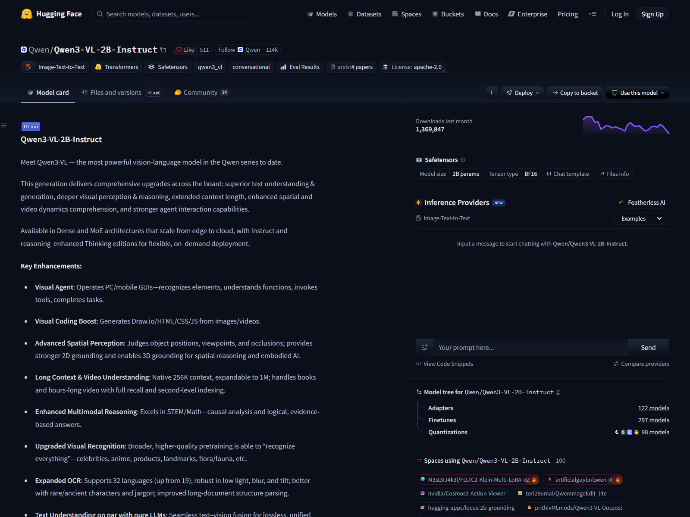
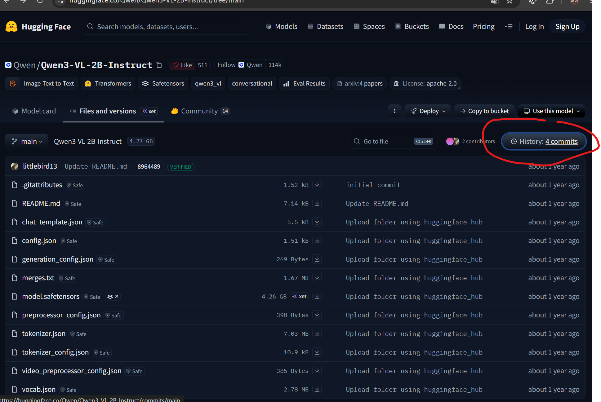
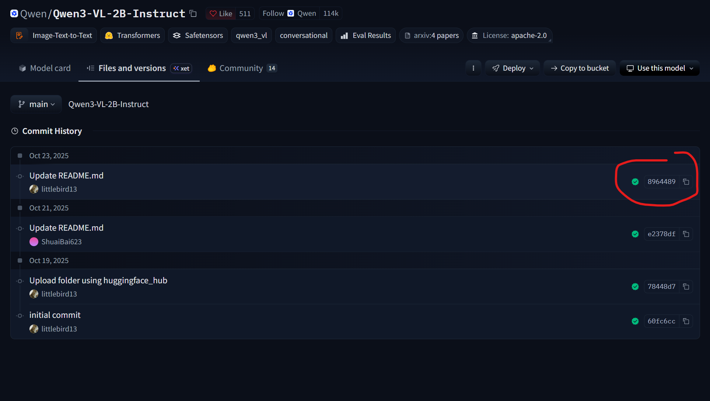
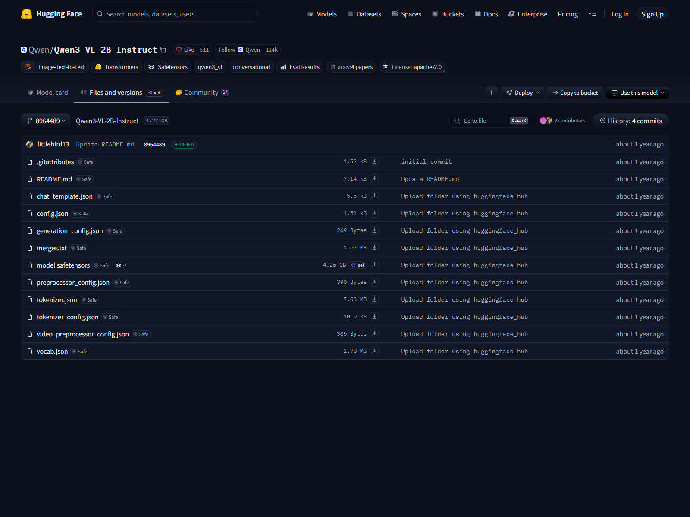
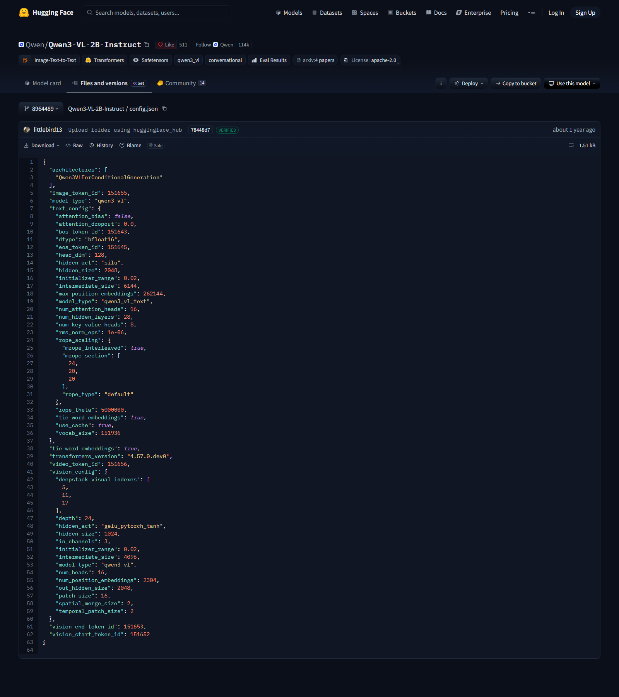

# VLM 模型接入流程

> 编写者 / 日期: 张翰为 / 2026-11-03
>
> 文档版本: v0.1.0
>
> 适用对象: 需要进行云端语言大模型部署、推理时优化、API开发和需要亲手搭建并理解完整流程的研发人员
>
> 对应路径: TUTORIAL.md

本文说明如何从 Hugging Face 模型页面开始，完成一个视觉语言模型（VLM）的评估、组件拆解、性能分析，再接入本推理引擎。文档中的示例 **Qwen3-VL-2B-Instruct**；

## 总体流程

```text
浏览并筛选 Hugging Face 模型
  → 固定 revision、检查许可证和文件
  → 下载到 checkpoints/，核对文件
  → Transformers 原生基线：Test → Bench → Profile
  → 按计算图拆解模块，逐层与官方实现对齐
  → 组装 modeling.py，接入 loader / runtime / components
  → 安装模型依赖，静态校验
  → 本地 Engine 与 FastAPI 直接端到端验收
```

Test、Bench、Profile 是正式接入 Engine 前的基线工作。先测清官方模型的正确性、资源和时间开销，再决定哪些代码需要接入或优化；不能用 Engine 结果替代 Transformers 基线。

## 1. 从 Hugging Face 页面查看模型

打开目标模型的 Hugging Face 仓库页面，依次检查 **Model card** 和 **Files and versions**。**不要只根据模型名称或参数量判断能否接入。**

检查项如下：

| 页面位置 | 要核对的内容 | 接入时记录 |
| --- | --- | --- |
| Model card | 任务类型、推荐用法、支持的图片/视频输入、示例、限制和评测说明 | 实际要支持的模态与测试提示词 |
| License | 权重许可证、额外限制、是否需申请访问 | 许可证名称和访问条件 |
| Files and versions | `config.json`、权重和索引、Tokenizer、Processor、模板文件是否齐全 | repo ID、目标 revision、必需文件清单 |
| `config.json` | `model_type`、`architectures`、文本与视觉配置、层数、维度、注意力头数 | Transformers 对应配置类和模型类 |
| safetensors 权重文件 | `.safetensors` 或分片索引是否存在，索引引用的分片是否齐全 | 文件格式、分片数量和总大小 |
| Processor / Tokenizer 配置 | `processor_config.json`、`preprocessor_config.json`、`tokenizer_config.json`、词表、特殊 token、chat template | 官方 Processor/Tokenizer 类和输入字段 |
| Python 文件 | 仓库是否带自定义 `modeling_*.py`、`processing_*.py` 等代码 | 是否必须加载远程代码；代码审查结论 |

### 示例：Qwen3-VL-2B-Instruct

下面的截图用于说明在 Hugging Face 页面上查看哪些信息。截图于 **2026-11-03** 从模型仓库页面取得，页面布局、下载量和文件内容之后可能变化；实际接入时要打开目标模型当前页面，并以选定的固定 revision 为准。

先打开huggingface模型仓库,  [示例仓库](https://huggingface.co/Qwen/Qwen3-VL-2B-Instruct)。在 **Model card** 页**检查模型 ID、任务标签、许可证和官方使用示例**。

> 注意: 页面上的能力介绍是模型方提供的信息，不等于本仓库已经实现了这些能力；计划支持的能力还要由官方示例和后续实测确认。



*图 1：模型卡页面。先确认仓库身份、任务类型、许可证和官方调用方式；下载量等动态指标不作为接入依据。*

进入 **Files and versions** 后，文件列表上方左侧的 `main` 只负责选择分支/标签。如果这里仅有 `main`，不要在这个下拉框里找历史 commit；点击右上角的 **History: N commits** 查看提交记录。



*图 2：从 `Files and versions` 页面点击右上角 **History: 4 commits**，进入提交历史。*

在提交历史里找到要复现的提交。示例中最新一条为 `Update README.md`，页面显示短 SHA `8964489`，右侧有复制图标。点复制图标后粘贴并确认拿到的是完整 40 位 SHA；如果得到的仍是短 SHA，就打开该提交，再从提交页面地址或详情中复制完整 SHA。不要把页面显示的 7 位短 SHA 写进模型配置。



*图 3：提交历史。选择正确的提交后复制完整 SHA；示例的完整 revision 是 `89644892e4d85e24eaac8bacfd4f463576704203`。*

用完整 SHA 打开固定版本的文件树，通用地址格式为 `https://huggingface.co/<组织>/<模型仓库>/tree/<完整40位SHA>`。

eg: https://huggingface.co/Qwen/Qwen3-VL-2B-Instruct/tree/89644892e4d85e24eaac8bacfd4f463576704203。

需要在该页面检查配置、Tokenizer/Processor、模板和权重文件，并确认权重索引引用的分片齐全。



*图 4：固定 revision 的文件树。这个快照使用单个 `model.safetensors`；其他模型可能使用多个分片和索引文件，接入时按实际文件树检查。*

最后打开该 revision 下的 `config.json`，从 `architectures`、`model_type` 和嵌套的文本/视觉配置开始，核对 Transformers 对应类及模型结构参数。将配置字段与官方 modeling 实现、权重 key 一起阅读。



*图 5：`config.json` 页面*

> 可以看见 `Qwen3VLForConditionalGeneration`、`qwen3_vl`、文本层维度等相关配置。页面旁的 `78448d7` 是该文件的最近修改记录；读取内容仍以打开的固定 revision 为准。

### 每次需要完成

1. 打开 [Model card](https://huggingface.co/Qwen/Qwen3-VL-2B-Instruct)，确认**任务**、**许可证**、**官方调用示例**和**模型限制**。
2. 点击 **Files and versions**，再点右上角 **History** 进入提交记录；选择目标提交，点击短 SHA 旁的复制按钮，粘贴并确认是完整 40 位 SHA。例如本例的完整 SHA 为：
3. 在固定版本下检查 `config.json`、权重与索引、Tokenizer、Processor、chat template 和其他模态配置文件。
4. 打开 `config.json` 和官方 Transformers 源码，整理模型组件、维度、层数、注意力布局、位置编码和权重命名，作为后续拆解与对齐依据。
5. 核对许可证与访问条件，评估权重磁盘空间、显存和依赖版本；确定实际要交付并验收的输入模态。

Qwen3-VL 示例信息：

| 字段 | 值 |
| --- | --- |
| Hugging Face repo | `Qwen/Qwen3-VL-2B-Instruct` |
| 固定 revision | `89644892e4d85e24eaac8bacfd4f463576704203` |
| 本地目录 | `checkpoints/Qwen3-VL-2B-Instruct-8964489` |
| API model ID | `qwen3-vl-2b` |
| 模态 | 文字、图片 |

## 2. 配置环境并下载固定版本

先进入项目环境。PyTorch/CUDA 应按目标机器的 NVIDIA 驱动和 CUDA 兼容矩阵单独安装；模型专属 Python 依赖则通过 Python 包的 **extra** 安装。extra 是一组可选依赖，例如 `qwen3-vl-2b` extra 会安装 Qwen3-VL 所需的 Python 包；它不包含模型权重，也不负责安装 PyTorch/CUDA。不同模型依赖不同，需按官方要求选择兼容版本。

把模型专属依赖写入 `src/inference/models/<model_name>/requirements/requirements.txt`，并在 `src/inference/pyproject.toml` 的 optional dependencies 声明对应 extra：

```toml
<model-extra> = { file = ["models/<model_name>/requirements/requirements.txt"] }
```

在仓库根目录安装当前模型 extra。新模型把 `qwen3-vl-2b` 替换成自己在 `pyproject.toml` 中声明的 extra 名称：

```bash
cd /mnt/e/workspace/MicroInfer
conda activate inference
python -m pip install -e "src/inference[qwen3-vl-2b]"
python -m pip check
```

`pip install -e .` 不会自动安装所有模型 extra；不要把模型专属依赖并入公共依赖。安装后检查 Python、PyTorch、Transformers 和 GPU 状态：

```bash
python -c '''import torch, transformers; print("torch", torch.__version__); print("transformers", transformers.__version__); print("cuda", torch.cuda.is_available()); print(torch.cuda.get_device_name(0) if torch.cuda.is_available() else "cpu")'''
```

### HF镜像特别说明

Hugging Face Hub 客户端会读取 `HF_ENDPOINT` 作为 Hub 地址。若运行环境访问官方站点不稳定，可在 **启动下载命令前** 设置镜像。下面的 `hf-mirror.com` 是第三方镜像，不是 Hugging Face 官方服务；按组织网络和安全要求选择可用镜像。镜像访问失败时，去掉该变量或改用组织批准的 Hub 代理。

```bash
# 正确写法：等号两侧不能有空格；设置在 import huggingface_hub / transformers 之前。
export HF_ENDPOINT=https://hf-mirror.com
echo "$HF_ENDPOINT"

# 使用官方 Hub (huggingface.co) 时：
# unset HF_ENDPOINT
```

Hugging Face 访问令牌只用于 gated/private 仓库。不要把令牌写进脚本、YAML、命令历史或 Git；在终端安全地导出 `HF_TOKEN`, 或使用本机 `hf auth login`。

然后使用仓库下载脚本。把 `MODEL_ID`、`REVISION` 和 `LOCAL_DIR` 替换成刚才在网页核对的信息：

```bash
python scripts/download.py \
  --repo-id "Qwen/Qwen3-VL-2B-Instruct" \
  --revision "89644892e4d85e24eaac8bacfd4f463576704203" \
  --local-dir "checkpoints/Qwen3-VL-2B-Instruct-8964489"
```

`scripts/download.py` 是通用模型制品准备工具，放在 `scripts/`；`tests/` 只维护模型级验收脚本。下载器使用 `huggingface_hub.snapshot_download()` 获取固定 revision 的完整快照。检查下载结果：

```bash
test -s "checkpoints/Qwen3-VL-2B-Instruct-8964489/config.json"
find "checkpoints/Qwen3-VL-2B-Instruct-8964489" -maxdepth 1 -type f -printf '%f\n' | sort
find "checkpoints/Qwen3-VL-2B-Instruct-8964489" -maxdepth 1 -name '*.safetensors' -o -name 'model.safetensors.index.json'
```

对分片权重，还要确认 `model.safetensors.index.json` 中 `weight_map` 引用的每个文件都存在。

**下载完成后，推理时设置本地路径和 `local_files_only: true`，让服务启动不再访问 Hub。**

可以用下面的小检查确认权重分片没有缺失：

```bash
vim check.py
```

写入：

```python
import json
import sys
from pathlib import Path

if len(sys.argv) != 2:
    raise SystemExit("用法：python check.py <本地模型目录>")

model_dir = Path(sys.argv[1])
index = model_dir / "model.safetensors.index.json"
if index.is_file():
    weight_map = json.loads(index.read_text(encoding="utf-8"))["weight_map"]
    missing = sorted(name for name in set(weight_map.values()) if not (model_dir / name).is_file())
    if missing:
        raise SystemExit(f"Missing weight shards: {missing}")
elif not list(model_dir.glob("*.safetensors")):
    raise SystemExit("No safetensors weights or safetensors index found")
print("weight files: complete")
```

执行检查：

```bash
python check.py "checkpoints/Qwen3-VL-2B-Instruct-8964489"
```

> 本示例中Qwen3-VL 示例是单个 `model.safetensors`，脚本会检查该文件存在；对分片权重则会检查索引中列出的每个分片。成功时输出 `weight files: complete`。

## 3. 先建立 Transformers 原生基线

在写 Engine 接入代码之前，先用 Hugging Face 官方模型类和 Processor 从本地目录加载模型。确定性测试使用固定输入、固定生成长度和关闭采样的配置；同一组输入之后也用于组件对齐、Bench 和 Profile。

注意: **固定复现条件：模型 revision、Python/PyTorch/Transformers 等依赖版本、素材及其校验值、提示词、随机种子、dtype、attention backend 和生成参数。**采样关闭时仍记录随机种子，以便其他随机预处理可复现。测试从本地权重加载，不在验收期间从 Hub 下载。

### Test：验证能力与正确性

Test 是模型能力和正确性的验收，不是性能测试。必须覆盖模型卡宣称且本服务准备开放的每种能力；每种能力使用固定素材和确定性参数，并按 Hugging Face 官方模型类、Processor、chat template 和 `generate()` 调用。下面的代码只演示一条图片请求；实际 `test.py` 还要按能力增加文本、多轮、图片边界及视频用例。未测试或端到端未支持的能力不得宣称可用。

#### 覆盖重点

| 能力/场景 | 必须验证 | 通过依据 |
| --- | --- | --- |
| 文本对话 | 单轮和多轮消息、chat template、最大上下文边界 | 官方 `generate()` 正常返回；停止 token 与预期一致；输出 token 合法 |
| 图片理解 | 单图、多图（若支持）、不同分辨率、文本与图片交错输入 | Processor 输出包含模型要求的 `input_ids`、像素张量及 `grid`、`size` 等字段；shape、dtype 与设备符合模型要求 |
| 视频理解（仅模型支持时） | 固定视频、帧抽取、时间戳、视频 Processor、帧数和时长限制 | 帧序列和时间信息正确编码；长度边界行为符合配置；服务端完成验证后才标为支持 |
| 生成与 Cache | 固定输出长度、关闭采样、EOS/停止 token、Cache 启用 | 记录生成 token 数和停止原因；Cache 被创建，并随官方生成步骤增长 |
| 输入输出与错误 | 输入输出 shape/dtype/device、无效输入、超限图片/视频、缺少必需字段 | 合法输入成功；非法输入以预期错误拒绝，不崩溃或静默截断 |

#### 必须记录

| 记录项 | 记录内容 |
| --- | --- |
| 模型与环境 | 上游 repo ID、完整 revision、依赖版本、GPU/驱动/CUDA、dtype、attention backend、随机种子 |
| 固定输入 | 用例 ID、提示词和轮次、图片/视频路径及 SHA-256、分辨率、图片数量、帧数和时间戳 |
| Processor 结果 | 所有输出字段；每个 Tensor 的 shape、dtype、device；关键 `input_ids`、像素和视觉 metadata |
| 生成结果 | 输出 token IDs、解码文本、token 数、EOS/停止 token、停止原因、推理耗时和状态 |
| Cache 与张量 | Cache 是否创建、生成各步的 Cache 长度、输入输出 shape/dtype/device |
| 失败用例 | 输入条件、预期行为、实际错误类型/信息及是否符合预期 |

#### Qwen3-VL 图片请求示例

```python
"""Transformers 基线 Test：校验 Qwen3-VL 图片输入和确定性生成。"""

import hashlib
import importlib.metadata
import json
import platform
import random
import shutil
import subprocess
import time
from datetime import datetime, timezone
from pathlib import Path

import torch
import transformers
import yaml
from PIL import Image
from transformers import AutoProcessor, Qwen3VLForConditionalGeneration

root = Path(__file__).resolve().parents[3]
config_path = root / "tests/qwen3_vl_2b/baseline/profiles/inference.yml"
config = yaml.safe_load(config_path.read_text(encoding="utf-8"))
model_path = (root / config["runtime"]["local_model_path"]).resolve()
revision = str(config["model"]["revision"])
image_path = root / "test.jpg"
prompt = "请简要描述图片中的主要内容。"
max_new_tokens = 2
seed = 2026
cuda = torch.cuda.is_available()
device = torch.device("cuda:0" if cuda else "cpu")
dtype = getattr(torch, str(config["model"]["dtype"]))
dependency_versions = {
    package: importlib.metadata.version(package)
    for package in ("torch", "transformers", "tokenizers", "huggingface-hub", "PyYAML", "Pillow")
}
driver_version = None
if cuda and shutil.which("nvidia-smi"):
    driver_result = subprocess.run(
        ["nvidia-smi", "--query-gpu=driver_version", "--format=csv,noheader"],
        capture_output=True, text=True, check=False,
    )
    if driver_result.returncode == 0:
        driver_version = driver_result.stdout.strip().splitlines()[0]

random.seed(seed)
torch.manual_seed(seed)
if cuda:
    torch.cuda.manual_seed_all(seed)

print("================= baseline =================")
if not (model_path / "model.safetensors").is_file() or not image_path.is_file():
    raise FileNotFoundError(f"请先准备本地权重和 test.jpg：{model_path}, {image_path}")
processor = AutoProcessor.from_pretrained(model_path, revision=revision, local_files_only=True)
model = Qwen3VLForConditionalGeneration.from_pretrained(
    model_path, revision=revision, local_files_only=True, use_safetensors=True,
    dtype=dtype, device_map=0 if cuda else "cpu",
    attn_implementation=str(config["model"]["attn_implementation"]),
).eval()
with Image.open(image_path) as opened_image:
    image = opened_image.convert("RGB")
messages = [{"role": "user", "content": [{"type": "image", "image": image}, {"type": "text", "text": prompt}]}]
inputs = processor.apply_chat_template(messages, tokenize=True, add_generation_prompt=True, return_dict=True, return_tensors="pt")
inputs = {key: value.to(model.device) if isinstance(value, torch.Tensor) else value for key, value in inputs.items() if key != "token_type_ids"}
inputs.setdefault("attention_mask", torch.ones_like(inputs["input_ids"]))
if "pixel_values" not in inputs or "input_ids" not in inputs:
    raise AssertionError("Processor 未返回 Qwen3-VL 所需的 input_ids 和 pixel_values。")

input_tensors = {
    key: {"shape": list(value.shape), "dtype": str(value.dtype), "device": str(value.device)}
    for key, value in inputs.items() if isinstance(value, torch.Tensor)
}
started = time.perf_counter()
with torch.inference_mode():
    generated = model.generate(**inputs, do_sample=False, max_new_tokens=max_new_tokens, use_cache=True, return_dict_in_generate=True)
elapsed_ms = (time.perf_counter() - started) * 1000
token_ids = generated.sequences[:, inputs["input_ids"].shape[-1]:].detach().cpu().reshape(-1).tolist()
output_sequences = generated.sequences
vocab_size = int(model.config.text_config.vocab_size)
if not 1 <= len(token_ids) <= max_new_tokens or min(token_ids) < 0 or max(token_ids) >= vocab_size:
    raise AssertionError("Transformers 返回了无效 token ID 或 token 数量。")
text = processor.batch_decode([token_ids], skip_special_tokens=True)[0].strip()
eos_token_id = model.generation_config.eos_token_id
eos_token_ids = set(eos_token_id if isinstance(eos_token_id, (list, tuple)) else [eos_token_id]) - {None}
cache = getattr(generated, "past_key_values", None)
if cache is None:
    raise AssertionError("官方 generate() 未返回 Cache；检查模型配置及 Transformers 输出。")
if hasattr(cache, "get_seq_length"):
    cache_tokens = int(cache.get_seq_length())
elif isinstance(cache, (tuple, list)) and cache and cache[0]:
    cache_tokens = int(cache[0][0].shape[-2])
else:
    raise AssertionError(f"无法识别该模型的 Cache 格式：{type(cache).__name__}")
if cache_tokens < inputs["input_ids"].shape[-1]:
    raise AssertionError("Cache 长度小于 prompt 长度。")
stopped_by_eos = bool(token_ids and token_ids[-1] in eos_token_ids)
stop_reason = "eos_token" if stopped_by_eos else "max_new_tokens" if len(token_ids) == max_new_tokens else "other"

report = {
    "schema_version": 1,
    "recorded_at_utc": datetime.now(timezone.utc).isoformat(),
    "model": {"repo_id": str(config["model"]["id"]), "revision": revision},
    "environment": {
        "python_version": platform.python_version(), "dependencies": dependency_versions,
        "torch_version": torch.__version__, "transformers_version": transformers.__version__,
        "cuda_version": torch.version.cuda, "nvidia_driver_version": driver_version,
        "device": str(device), "gpu_name": torch.cuda.get_device_name(0) if cuda else "CPU",
        "dtype": str(model.dtype), "attention_backend": str(config["model"]["attn_implementation"]), "seed": seed,
    },
    "workload": {
        "case_id": "single_image_chat", "prompt": prompt,
        "image_sha256": hashlib.sha256(image_path.read_bytes()).hexdigest(),
        "image_width": image.width, "image_height": image.height,
        "processor_tensors": input_tensors, "max_new_tokens": max_new_tokens, "do_sample": False,
    },
    "result": {
        "status": "passed", "input_shape": list(inputs["input_ids"].shape),
        "output_shape": list(output_sequences.shape), "output_dtype": str(output_sequences.dtype),
        "output_device": str(output_sequences.device),
        "generated_token_ids": token_ids, "generated_token_count": len(token_ids),
        "generated_text": text, "stopped_by_eos": stopped_by_eos, "stop_reason": stop_reason,
        "eos_token_id": model.generation_config.eos_token_id,
        "cache_created": True, "cache_tokens_after_generation": cache_tokens,
    },
    "metrics": {"latency_ms": elapsed_ms},
}
output_path = root / "artifacts/qwen3_vl_2b/baseline/test.json"
output_path.parent.mkdir(parents=True, exist_ok=True)
output_path.write_text(json.dumps(report, ensure_ascii=False, indent=2) + "\n", encoding="utf-8")
print("status:", report["result"]["status"])
print("generated_token_ids:", token_ids)
print("generated_text:", text)
print("json:", output_path)
```

### Bench：测基线的性能

Bench 是固定工作负载下的性能测量。与 Test 使用相同的本地 snapshot、输入、Processor、dtype、attention backend、生成参数和随机种子；先预热，再重复测量。下面的示例只测单请求 `model.generate()` 的生成耗时，不包含模型加载和 Processor 前处理，也不把它拆称 Prefill/Decode 各自耗时。

#### 覆盖重点

| 场景 | 必须验证 | 通过依据 |
| --- | --- | --- |
| 固定工作负载 | 使用 Test 中相同的提示词、素材、分辨率、输入字段、dtype 和输出长度 | 每轮输入 token 数一致，素材 SHA-256 与 Test 一致 |
| 预热与测量 | 先预热，再运行多轮；CUDA 计时前后同步 | 不把首次加载/编译等冷启动开销混入稳定延迟；保留每轮原始延迟 |
| 正确性约束 | 每轮生成结果与 Test 的确定性 token 结果比较 | token 不一致时该 Bench 报告标记失败，不将异常性能数字作为有效基线 |
| 计时范围 | 明确计时是否包含图片解码、Processor、Prefill、Decode 和模型加载 | 本示例仅计 `model.generate()`，不得称作 Prefill 或 Decode 单独耗时 |
| 设备与容量 | CUDA 可用时在 CUDA 测；CPU 仅在 CUDA 不可用时回退 | 记录 GPU、CUDA、驱动和峰值显存；单请求结果不宣称并发服务容量 |

#### 必须记录

| 记录项 | 记录内容 |
| --- | --- |
| 固定身份 | 模型 repo、完整 revision、依赖版本、素材 SHA-256、提示词、随机种子 |
| 测量设置 | 预热次数、正式测量次数、计时范围、`do_sample`、`max_new_tokens`、dtype、attention backend |
| 每轮数据 | 每轮延迟、生成 token 数、是否与 Test token 一致 |
| 汇总指标 | 延迟中位数、token/s 中位数、CUDA peak allocated/reserved |
| 运行环境 | Python、PyTorch、Transformers、CUDA、驱动、GPU 型号和运行设备 |

#### Qwen3-VL 图片请求示例

```python
"""Transformers 基线 Bench：测量固定图片请求的生成延迟与吞吐。"""

import hashlib
import json
import statistics
import time
from datetime import datetime, timezone
from pathlib import Path

import torch
import yaml
from PIL import Image
from transformers import AutoProcessor, Qwen3VLForConditionalGeneration

root = Path(__file__).resolve().parents[3]
config_path = root / "tests/qwen3_vl_2b/baseline/profiles/inference.yml"
config = yaml.safe_load(config_path.read_text(encoding="utf-8"))
model_path = (root / config["runtime"]["local_model_path"]).resolve()
revision = str(config["model"]["revision"])
image_path = root / "test.jpg"
prompt = "请简要描述图片中的主要内容。"
max_new_tokens, seed, warmups, iterations = 2, 2026, 1, 3
cuda = torch.cuda.is_available()
device = torch.device("cuda:0" if cuda else "cpu")
dtype = getattr(torch, str(config["model"]["dtype"]))
torch.manual_seed(seed)
if cuda:
    torch.cuda.manual_seed_all(seed)

print("================= baseline =================")
test_path = root / "artifacts/qwen3_vl_2b/baseline/test.json"
test_report = json.loads(test_path.read_text(encoding="utf-8"))
reference_token_ids = test_report["result"]["generated_token_ids"]
if test_report["model"]["revision"] != revision:
    raise AssertionError("Bench 与 Test 的模型 revision 不一致。")
if test_report["workload"]["prompt"] != prompt or int(test_report["workload"]["max_new_tokens"]) != max_new_tokens:
    raise AssertionError("Bench 与 Test 的提示词或生成长度不一致。")
if not (model_path / "model.safetensors").is_file() or not image_path.is_file():
    raise FileNotFoundError(f"请先准备本地权重和 test.jpg：{model_path}, {image_path}")

processor = AutoProcessor.from_pretrained(model_path, revision=revision, local_files_only=True)
model = Qwen3VLForConditionalGeneration.from_pretrained(
    model_path, revision=revision, local_files_only=True, use_safetensors=True,
    dtype=dtype, device_map=0 if cuda else "cpu",
    attn_implementation=str(config["model"]["attn_implementation"]),
).eval()
with Image.open(image_path) as opened_image:
    image = opened_image.convert("RGB")
if hashlib.sha256(image_path.read_bytes()).hexdigest() != test_report["workload"]["image_sha256"]:
    raise AssertionError("Bench 图片与 Test 图片不一致。")
messages = [{"role": "user", "content": [{"type": "image", "image": image}, {"type": "text", "text": prompt}]}]
inputs = processor.apply_chat_template(messages, tokenize=True, add_generation_prompt=True, return_dict=True, return_tensors="pt")
inputs = {key: value.to(model.device) if isinstance(value, torch.Tensor) else value for key, value in inputs.items() if key != "token_type_ids"}
inputs.setdefault("attention_mask", torch.ones_like(inputs["input_ids"]))
input_tensors = {
    key: {"shape": list(value.shape), "dtype": str(value.dtype), "device": str(value.device)}
    for key, value in inputs.items() if isinstance(value, torch.Tensor)
}
if int(inputs["input_ids"].shape[-1]) != int(test_report["workload"]["prompt_tokens"]):
    raise AssertionError("Bench prompt token 数与 Test 不一致。")

for _ in range(warmups):
    with torch.inference_mode():
        model.generate(**inputs, do_sample=False, max_new_tokens=max_new_tokens)
if cuda:
    torch.cuda.synchronize(device)
    torch.cuda.reset_peak_memory_stats(device)

latencies_ms, token_counts, token_matches = [], [], []
for _ in range(iterations):
    if cuda:
        torch.cuda.synchronize(device)
    started = time.perf_counter()
    with torch.inference_mode():
        output = model.generate(**inputs, do_sample=False, max_new_tokens=max_new_tokens)
    if cuda:
        torch.cuda.synchronize(device)
    latencies_ms.append((time.perf_counter() - started) * 1000)
    token_ids = output[:, inputs["input_ids"].shape[-1]:].detach().cpu().reshape(-1).tolist()
    token_counts.append(len(token_ids))
    token_matches.append(token_ids == reference_token_ids)

metrics = {
    "warmup_iterations": warmups, "measured_iterations": iterations,
    "latency_scope": "model.generate only; excludes model loading and processor preprocessing",
    "latency_ms_samples": latencies_ms, "latency_ms_median": statistics.median(latencies_ms),
    "tokens_per_second_median": statistics.median(count / (ms / 1000) for count, ms in zip(token_counts, latencies_ms)),
    "generated_token_counts": token_counts, "token_match_all_runs": all(token_matches),
    "peak_cuda_memory_bytes": torch.cuda.max_memory_allocated(device) if cuda else 0,
    "peak_cuda_reserved_bytes": torch.cuda.max_memory_reserved(device) if cuda else 0,
}
report = {
    "schema_version": 1, "recorded_at_utc": datetime.now(timezone.utc).isoformat(),
    "model": {"name": "qwen3_vl_2b", "alias": "qwen3-vl-2b", "repo_id": "Qwen/Qwen3-VL-2B-Instruct", "revision": revision},
    "implementation": "baseline", "task": "bench",
    "environment": {"python_version": test_report["environment"]["python_version"], "dependencies": test_report["environment"]["dependencies"], "device": str(device), "gpu_name": torch.cuda.get_device_name(0) if cuda else "CPU", "nvidia_driver_version": test_report["environment"]["nvidia_driver_version"], "torch_version": torch.__version__, "cuda_version": torch.version.cuda, "dtype": str(model.dtype), "attention_backend": str(config["model"]["attn_implementation"])},
    "workload": {"input_type": "image", "case_id": "single_image_chat", "image_sha256": hashlib.sha256(image_path.read_bytes()).hexdigest(), "image_width": image.width, "image_height": image.height, "prompt": prompt, "prompt_tokens": int(inputs["input_ids"].shape[-1]), "processor_tensors": input_tensors, "max_new_tokens": max_new_tokens, "do_sample": False, "seed": seed},
    "result": {"status": "passed" if all(token_matches) else "failed", "reference_token_match_all_runs": all(token_matches)},
    "metrics": metrics, "operator_records": [], "trace_path": None,
}
output_path = root / "artifacts/qwen3_vl_2b/baseline/bench.json"
output_path.parent.mkdir(parents=True, exist_ok=True)
output_path.write_text(json.dumps(report, ensure_ascii=False, indent=2) + "\n", encoding="utf-8")
print(f"latency_median_ms: {metrics['latency_ms_median']:.3f}")
print(f"throughput_median_tokens_s: {metrics['tokens_per_second_median']:.3f}")
print("json:", output_path)
if not all(token_matches):
    raise AssertionError(f"Bench 输出与 Test token 不一致，记录见 {output_path}")
```

### Profile：分析前向与算子

Profile 分析算子时间与内存分布，用于解释 Bench 发现的瓶颈，不替代 Bench。此处示例只采集 Transformers 官方实现的 Prefill：Processor 和模型前向使用同一固定图文输入；profiler 只包住一次 `model(**inputs, use_cache=True)`，不将模型加载、图像处理或 Decode 混进 Prefill trace。可以先用 PyTorch Profiler 找到值得追踪的算子；需要观察 CPU 调度、CUDA API 和 Kernel 时间线时再使用 Nsight Systems；定位到具体 Kernel 后再用 Nsight Compute 读取硬件计数器。每个优化候选记录**问题、证据、拟改模块、正确性门槛、Bench baseline、Profile 证据和结果**。

#### 覆盖重点

| 分析对象 | 必须检查 | 通过依据 |
| --- | --- | --- |
| Prefill 前向 | 固定图文输入的视觉塔、文本层和 logits 计算 | 输入 token 数与 Test 相同；KV Cache 创建且长度覆盖 prompt |
| 算子与张量 | Attention、GEMM、Norm、RoPE、视觉算子等实际出现的 operator/kernel | 保存输入 shape、调用次数、CPU/CUDA 时间和显存分配；不凭算子名称推断瓶颈 |
| 计时与追踪 | 记录 shapes、memory，并导出 Chrome trace | CUDA 使用 Event 并同步；CPU fallback 时标明 CPU wall time |
| Profile 范围 | baseline 先用 Transformers；enhanced 通过后再用同一 workload 分析 Inference | 两份 trace 的 revision、素材、输入 token 数、dtype 和设备可比较 |
| VLM 特有路径 | 图片尺寸/视觉 token 数、MRoPE 或模型专属位置状态、Cache 写入 | 按官方模型生成实现解释；Qwen 的状态假设不照搬到其他 VLM |

#### 必须记录

| 记录项 | 记录内容 |
| --- | --- |
| 固定身份与环境 | repo、完整 revision、依赖版本、GPU/驱动/CUDA、dtype、attention backend、素材 SHA-256 |
| Prefill 输入输出 | prompt token 数、Processor tensor 字段及 shape/dtype/device、logits shape、Cache 长度 |
| 每个 operator | 名称、输入 shape、调用次数、self CPU/CUDA 时间、CPU/CUDA memory usage |
| Profiler 设置 | CPU/CUDA activities、record_shapes、profile_memory、stack 开关、trace 路径 |
| 测量范围 | Profiler 包含的模型调用；未纳入的模型加载、前处理、Decode 等环节 |

#### Qwen3-VL 图片请求示例

```python
"""Transformers 基线 Profile：采集固定图文 Prompt 的 Prefill 算子。"""

import hashlib
import json
import time
from datetime import datetime, timezone
from pathlib import Path

import torch
import yaml
from PIL import Image
from transformers import AutoProcessor, Qwen3VLForConditionalGeneration

root = Path(__file__).resolve().parents[3]
config_path = root / "tests/qwen3_vl_2b/baseline/profiles/inference.yml"
config = yaml.safe_load(config_path.read_text(encoding="utf-8"))
model_path = (root / config["runtime"]["local_model_path"]).resolve()
revision = str(config["model"]["revision"])
image_path = root / "test.jpg"
prompt = "请简要描述图片中的主要内容。"
cuda = torch.cuda.is_available()
device = torch.device("cuda:0" if cuda else "cpu")
dtype = getattr(torch, str(config["model"]["dtype"]))
activities = [torch.profiler.ProfilerActivity.CPU]
if cuda:
    activities.append(torch.profiler.ProfilerActivity.CUDA)

print("================= baseline =================")
test_path = root / "artifacts/qwen3_vl_2b/baseline/test.json"
test_report = json.loads(test_path.read_text(encoding="utf-8"))
if test_report["model"]["revision"] != revision or test_report["workload"]["prompt"] != prompt:
    raise AssertionError("Profile 与 Test 的模型 revision 或提示词不一致。")
if not (model_path / "model.safetensors").is_file() or not image_path.is_file():
    raise FileNotFoundError(f"请先准备本地权重和 test.jpg：{model_path}, {image_path}")
processor = AutoProcessor.from_pretrained(model_path, revision=revision, local_files_only=True)
model = Qwen3VLForConditionalGeneration.from_pretrained(
    model_path, revision=revision, local_files_only=True, use_safetensors=True,
    dtype=dtype, device_map=0 if cuda else "cpu",
    attn_implementation=str(config["model"]["attn_implementation"]),
).eval()
with Image.open(image_path) as opened_image:
    image = opened_image.convert("RGB")
if hashlib.sha256(image_path.read_bytes()).hexdigest() != test_report["workload"]["image_sha256"]:
    raise AssertionError("Profile 图片与 Test 图片不一致。")
messages = [{"role": "user", "content": [{"type": "image", "image": image}, {"type": "text", "text": prompt}]}]
inputs = processor.apply_chat_template(messages, tokenize=True, add_generation_prompt=True, return_dict=True, return_tensors="pt")
inputs = {key: value.to(model.device) if isinstance(value, torch.Tensor) else value for key, value in inputs.items() if key != "token_type_ids"}
inputs.setdefault("attention_mask", torch.ones_like(inputs["input_ids"]))
prompt_tokens = int(inputs["input_ids"].shape[-1])
if prompt_tokens != int(test_report["workload"]["prompt_tokens"]):
    raise AssertionError("Profile prompt token 数与 Test 不一致。")
input_tensors = {
    key: {"shape": list(value.shape), "dtype": str(value.dtype), "device": str(value.device)}
    for key, value in inputs.items() if isinstance(value, torch.Tensor)
}
trace_path = root / "artifacts/qwen3_vl_2b/traces/baseline-prefill.json"
trace_path.parent.mkdir(parents=True, exist_ok=True)
if cuda:
    torch.cuda.reset_peak_memory_stats(device)
    start_event = torch.cuda.Event(enable_timing=True)
    end_event = torch.cuda.Event(enable_timing=True)
else:
    start_event = end_event = None

started = time.perf_counter()
with torch.profiler.profile(activities=activities, record_shapes=True, profile_memory=True, with_stack=True) as profile:
    if start_event:
        start_event.record()
    with torch.inference_mode():
        output = model(**inputs, use_cache=True, return_dict=True)
    if end_event:
        end_event.record()
        end_event.synchronize()
prefill_ms = float(start_event.elapsed_time(end_event)) if cuda else (time.perf_counter() - started) * 1000
if output.past_key_values is None:
    raise RuntimeError("Prefill 没有返回 KV Cache。")
cache_tokens = int(output.past_key_values.get_seq_length())
if cache_tokens != prompt_tokens:
    raise AssertionError(f"Prefill Cache 长度 {cache_tokens} 与输入长度 {prompt_tokens} 不一致。")
profile.export_chrome_trace(str(trace_path))

operators = []
for event in profile.key_averages(group_by_input_shape=True):
    operators.append({
        "phase": "prefill", "operator": str(event.key), "input_shapes": event.input_shapes,
        "call_count": int(event.count),
        "self_device_time_total_us": float(getattr(event, "self_device_time_total", getattr(event, "self_cuda_time_total", 0)) or 0),
        "self_cpu_time_total_us": float(event.self_cpu_time_total),
        "self_device_memory_usage_bytes": int(getattr(event, "self_device_memory_usage", getattr(event, "self_cuda_memory_usage", 0)) or 0),
        "self_cpu_memory_usage_bytes": int(event.self_cpu_memory_usage),
    })
operators.sort(key=lambda item: item["self_device_time_total_us"], reverse=True)
print(profile.key_averages(group_by_input_shape=True).table(sort_by="self_device_time_total" if cuda else "self_cpu_time_total", row_limit=30))

report = {
    "schema_version": 1, "recorded_at_utc": datetime.now(timezone.utc).isoformat(),
    "model": {"name": "qwen3_vl_2b", "alias": "qwen3-vl-2b", "repo_id": "Qwen/Qwen3-VL-2B-Instruct", "revision": revision},
    "implementation": "baseline", "task": "prefill",
    "environment": {"python_version": test_report["environment"]["python_version"], "dependencies": test_report["environment"]["dependencies"], "device": str(device), "gpu_name": torch.cuda.get_device_name(0) if cuda else "CPU", "nvidia_driver_version": test_report["environment"]["nvidia_driver_version"], "torch_version": torch.__version__, "cuda_version": torch.version.cuda, "dtype": str(model.dtype), "attention_backend": str(config["model"]["attn_implementation"])},
    "workload": {"input_type": "image", "case_id": "single_image_chat", "image_sha256": hashlib.sha256(image_path.read_bytes()).hexdigest(), "image_width": image.width, "image_height": image.height, "prompt": prompt, "prompt_tokens": prompt_tokens, "processor_tensors": input_tensors},
    "result": {"status": "passed", "query_tokens": prompt_tokens, "cache_tokens_after_prefill": cache_tokens, "logits_shape": list(output.logits.shape)},
    "metrics": {"prefill_latency_ms": prefill_ms, "peak_cuda_memory_bytes": torch.cuda.max_memory_allocated(device) if cuda else 0, "peak_cuda_reserved_bytes": torch.cuda.max_memory_reserved(device) if cuda else 0},
    "operator_records": operators, "trace_path": str(trace_path),
}
output_path = root / "artifacts/qwen3_vl_2b/baseline/prefill.json"
output_path.parent.mkdir(parents=True, exist_ok=True)
output_path.write_text(json.dumps(report, ensure_ascii=False, indent=2, default=str) + "\n", encoding="utf-8")
print("prefill_ms:", round(prefill_ms, 3), "operator_records:", len(operators))
print("trace:", trace_path)
print("json:", output_path)
```

## 4. 拆解模型并逐个组件对齐

根据 `config.json`、官方 modeling 源码和权重 key，**画出该模型的前向结构**。按计算职责拆解，不按文件数量拆解：例如 `Patch Embedding → Vision Blocks → Merger`，以及 `Token Embedding → Decoder Layers → Norm → LM Head`。如果模型有额外的 Resampler、Projector、跨模态融合、视频时序模块或额外视觉特征，就按真实拓扑添加。

| 模块 | 应确认的官方行为 | 本仓库常见归属 |
| --- | --- | --- |
| Embedding / Patch Embedding | 输入布局、patch 顺序、位置编码、输出 shape | `layers/` |
| Attention / RoPE / Norm / MLP | QKV 布局、mask、位置编码、激活和数值精度 | 各自的 `layers/*.py` |
| Decoder Layer / Vision Block | 残差顺序、Norm 位置、子模块连接 | `layers/` 中的组合层 |
| Projector / Merger / Resampler | 视觉到文本维度映射、token 合并策略 | `layers/` 或 `architecture/` |
| 完整视觉塔、文本塔、跨模态主干、生成模型 | checkpoint 模块路径和整体前向 | `modeling.py` 直接组装；模型专属类型放 `architecture/` |
| Tokenizer / Processor / 图像或视频适配 | Chat Template、预处理、视觉字段、校验 | `components/` 与 `architecture/` 按通用运行职责/模型特性划分 |
| Prefill / Decode / Cache 状态 | 新 token 准备、缓存续接、取消与结束清理 | `components/stepwise_generation.py` 等 |
| Runner / Adapter | Engine 生命周期和请求结果映射 | `components/` |

尽量每个自研计算层都提供独立的小型 `__main__` 前向入口便于组件级的分析以减少后续bug：在 CUDA 可用时默认用 CUDA，否则 CPU；构造相同配置的官方参考层和本地层，将参考权重复制/映射到本地层，用同一输入做 `eval()` 与 `torch.inference_mode()` 对比，断言输出 shape 和 `torch.testing.assert_close()`。测试随机参数只能验证接口形状；有 checkpoint 时还要做真实权重 key/数值对齐。

**组件入口须以包模块方式运行**，模型层使用包内相对导入。

(直接运行文件会丢失包上下文并报 `attempted relative import with no known parent package` )

```bash
python -m inference.models.mage_vl_4b.layers.vision_attention
python -m inference.models.qwen3_vl_2b.layers.text_attention
```

按模型结构编写，不是固定清单：模型不需要的文件不要创建。出现权重 key 无法匹配、Processor 字段缺失或官方前向不支持时，先定位架构差异，不用 `strict=False` 掩盖未加载权重。

## 5. 按仓库规范实现模型包

模型目录统一为下面的形状。根目录只放四个 Python 入口；YAML 放 `profiles/`，依赖放 `requirements/`；`architecture/__init__.py` 保留为空。目录内部文件依据模型能力增减：

```text
src/inference/models/<model_name>/
├── README.md                  # 模型架构、模块映射、能力边界和运行说明
├── example.py                 # 最小实际调用示例；VLM 展示图片输入和流式输出
├── loader.py                  # 本模型配置读取、路径解析和 Processor/权重加载所需设置
├── modeling.py                # 直接导入本地层并显式组装模型拓扑
├── runtime.py                 # 简单组合 ModelRunner、Adapter，导出 Engine Client
├── architecture/
│   ├── __init__.py            # 空包标记，保持模型间目录一致
│   └── ...                    # Config、输出类型和模型专属模态能力（按需）
├── layers/                    # 细粒度计算层；每个独立层可运行 main 对齐测试（按需）
├── components/                # tokenizer、encoder、generation、runner、adapter（按需）
├── profiles/
│   ├── model.yml              # alias、能力、runtime_factory、配置文件名
│   ├── inference.yml          # 模型版本/路径及 Engine 运行参数
│   └── network.yml            # API 地址和媒体端点
└── requirements/
    └── requirements.txt       # 本模型专属 Python 依赖
```

### 四个入口各写什么

| 文件 | 实现内容 | 约束 |
| --- | --- | --- |
| `modeling.py` | 导入已实现的 `layers/`，显式组装 Vision、Text、Fusion、Conditional Generation 模块 | 让官方 checkpoint key 按标准模块路径加载；不要用动态工厂、注册表或黑盒整体替换 |
| `loader.py` | 读取启动器已选中的配置，解析本地权重目录，提供模型类/Processor 初始化所需常量 | 配置里的权重路径使用本地 `checkpoints/`；生产请求不临时下载 |
| `runtime.py` | 创建 Runner 与 Adapter，封装成共用 `ModelRuntime`，导出 `create_engine_client()` | 复用共用 Engine/Worker，不复制一套服务和调度器 |
| `example.py` | 创建 Engine Client、传入文本和图片、打印流式结果 | 所有 import 放顶部；保留直接可读的调用流程，使用本模型 `profiles/inference.yml` |

`modeling.py` 是完整架构组装处。不要把 assembled model 放到 `model/` 子目录，也不要新增 `party.py` 或模型级 `utils/` 作为杂项聚集点。模型 YAML 只存模型版本、路径、dtype、设备、Attention backend、上下文/缓存容量和请求限制等运行值，不用 YAML 选择或拼装 Python 层组件。

### 每个模型需要维护的说明文件

接入负责人需要在代码与模型级验收目录分别维护 README。前者回答“模型在本仓库如何实现”，后者回答“如何复现测试和分析”：

| 文件 | 必须说明的内容 |
| --- | --- |
| `src/inference/models/<model_name>/README.md` | 上游模型 ID 与 revision、API alias 和能力边界；模型前向拓扑；`architecture/`、`layers/`、`components/` 与 `modeling.py` 的职责映射；配置、依赖和最小 `example.py` 运行方法；与官方 Transformers 的实现差异或注意事项。 |
| `tests/<model_name>/README.md` | 运行环境、权重与输入素材；baseline/enhanced 的 `test.py`、`bench.py`、`prefill.py` 分工和运行命令；`profiles/inference.yml` 用途；JSON 输出 schema 与产物路径；`analysis.py` 读取和生成什么；验收门槛、硬件与 revision 记录方式；能力未覆盖项。 |

模型级目录统一采用以下布局；各模型 README 以实际能力为准，不复制无关功能：

```text
tests/<model_name>/
├── README.md                  # 本模型 Test/Bench/Profile 与产物说明
├── analysis.py                # 汇总 JSON 并生成 CSV/XLSX 分析表
├── baseline/
│   ├── test.py                # Transformers 基线功能验收
│   ├── bench.py               # Transformers 基线性能测量
│   ├── prefill.py             # Transformers Prefill 算子 Profile
│   └── profiles/inference.yml # 基线独立参数副本
└── enhanced/
    ├── test.py                # Inference 功能验收，与 baseline token 对齐
    ├── bench.py               # Inference 性能测量
    ├── prefill.py             # Inference Prefill 算子 Profile
    └── profiles/inference.yml # 增强实现独立参数副本
```

测试数据统一写为 JSON：baseline 与 enhanced 各自按 `test.json`、`bench.json`、`prefill.json` 保存到 `artifacts/<model_name>/<implementation>/`；Prefill trace 单独写到同模型的 `artifacts/` 子目录。`analysis.py` 读取六份 JSON，生成 `analysis/<model_name>/analysis.csv` 和 `analysis.xlsx`。新增模型后，在根目录模型列表中加入模型实现 README 与对应测试 README 的链接。不要把两份模型说明合并成一个通用文档，也不要只增加目录而不填写 README。

### 模型运行配置

`profiles/model.yml` 是模型发现和能力声明入口。下面仅是 Qwen3-VL 案例；新模型 alias、输入模态和能力必须依据代码及实测结果填写：

```yaml
alias: qwen3-vl-2b
display_name: Qwen3-VL-2B-Instruct
integration_profile: custom
backend: transformers
runtime_factory: inference.models.qwen3_vl_2b.runtime:create_runtime
inference_config: inference.yml
network_config: network.yml
api:
  model_id: qwen3-vl-2b
  capabilities:
    chat_inputs: [text, image]
    streaming: true
    tool_calling: false
    output_mode: text_delta
    video_upload: false
    live_video: false
```

`profiles/inference.yml` 保存运行参数；至少固定 Hub repo ID、完整 revision、dtype、attention backend、本地权重路径和 `local_files_only: true`。图片最大尺寸、图片数、上下文、生成长度和 KV reservation 按实际 GPU 与 API 限制制定。`profiles/network.yml` 配置 API 监听地址及可选的媒体端点：

```yaml
api:
  host: 127.0.0.1
  port: 8012
```

服务不要求 API Key，也不按 tenant 限流；部署时应通过网络配置限制 API 的访问范围。测试的 baseline 与 enhanced 目录各自保存一份 `profiles/inference.yml` 参数副本；增强实现从模型源码目录读取 manifest 与 network 注册配置。

模型专属 Python 依赖文件和 extra 的声明/安装在步骤 2 完成；本步骤只配置模型发现、运行参数和网络服务参数。

## 6. 接入 Engine 并逐级验收

所有 Transformers 基线与组件对齐通过后，再接 Engine。按顺序实现并检查：

1. `components/tokenizer.py`：调用模型官方 tokenizer/processor 和 chat template；保留多模态 tensor 与 grid/时间戳等必要 metadata。
2. `architecture/` 的输入能力实现及 `components/encoder.py`：验证 OpenAI 消息内容、图片/帧大小、请求上限和生成参数；将 Processor 输入放到正确 device/dtype。
3. `components/stepwise_generation.py`：把 Prefill、每步 Decode、Cache、位置编码状态、EOS、取消和资源清理适配到 Engine 工作项。先让官方 `generate()` 作为正确性来源，再接入逐步生成。
4. `modeling.py` 与 `components/model_runner.py`：显式加载本地模块和权重，验证完整输入至 logits/生成文本。
5. `components/adapter.py`、`runtime.py`：把请求和结果映射到共用 worker 契约；不要让模型提出 tool call 就直接执行外部工具，工具授权与执行在 Agent 层。
6. 更新 `model.yml` 的能力。只声明已经实现并测试的能力；模型 extra 已在步骤 2 声明并安装。

启动器预检不加载权重：

```bash
inference list
inference validate --model <model-alias>
```

```bash
inference serve --model <model-alias>
```

端到端验收从另一个终端直接调用模型 FastAPI 的 OpenAI 兼容 `POST /v1/chat/completions`，不需要 API Key：

```bash
curl http://127.0.0.1:8012/v1/chat/completions \
  -H 'Content-Type: application/json' \
  -d '{"model":"<model-alias>","messages":[{"role":"user","content":"请介绍一下这个模型。"}],"stream":true}'
```

使用模型 manifest 中登记的 API model ID，例如 `mage-vl-4b`、`qwen3-vl-2b`。`scripts/client.py` 可验证当前两个模型的请求；新模型需将上例 URL 和 model alias 替换为自己的配置。图像、视频和工具调用能力分别准备真实请求验收，没有测过的能力必须标为 `false`。控制面负责用户认证与业务授权，并在服务端调用 FastAPI；控制面不属于本仓库。

## 7. 结果与复现记录

每个模型至少保留以下结果：

| 结果 | 内容 |
| --- | --- |
| Transformers Test | 成功/失败、模型 SHA、输入素材标识、输出与 tensor 检查 |
| Transformers Bench | 输入长度/视觉规模、生成 token 数、延迟、吞吐、峰值显存和环境 |
| Transformers Profile | Prefill/Decode 分段 trace、算子 shape/时间/内存、分析结论 |
| 层级对齐 | 官方参考模块、本地模块、加载权重情况、误差阈值和断言结果 |
| Engine 验收 | 静态 validate、模型启动、直接 FastAPI 的图文流式结果 |

Prefill Profile 由熟悉该模型的工程师维护在 `tests/<model_name>/{baseline,enhanced}/prefill.py`；它需要按模型官方生成逻辑准备输入和 Cache，不能照抄其他模型的内部状态假设。六个脚本都输出可机器读取的 JSON；`tests/<model_name>/analysis.py` 汇总并生成 `analysis/<model_name>/analysis.csv` 与 `analysis.xlsx`。问题、证据、解决方案、效果及未验证项写在同目录 `analysis.md`。权重、个人密钥和大体积 trace 不进 Git。

## FAQ

| 现象 | 先检查 |
| --- | --- |
| 下载命令仍访问 huggingface.co | `HF_ENDPOINT` 是否在 Python 进程启动前导出；Python 是否已在 shell 中提前 import Hub 包；镜像当前是否可访问 |
| 下载成功但模型加载找不到文件 | 固定 revision 是否一致；分片 index 是否指向缺失文件；Processor/Tokenizer 文件是否完整；运行 YAML 是否指向正确目录 |
| `AutoModel` 无法识别架构 | Transformers 版本是否与模型要求匹配；是否要更新到官方支持该架构的版本；远程代码需审阅后再决定，不要直接启用 |
| 视觉输出与官方不同 | chat template、图片缩放/裁剪、grid/视频帧 metadata、dtype、attention backend 和 special token 是否一致 |
| Decode query 长度不是 1 | 使用模型官方 `prepare_inputs_for_generation()` 检查新 token 输入；避免把整个 prompt 再送入 Decode |
| CUDA OOM | 记录图片分辨率/patch 数、prompt、输出长度、dtype、并发和显存；降低受控负载后重新做同配置 Bench/Profile |

## 官方资料

| 资料 | 用途 |
| --- | --- |
| [Hugging Face Hub：环境变量](https://huggingface.co/docs/huggingface_hub/en/package_reference/environment_variables) | 配置 Hub endpoint、访问令牌和缓存目录；本流程用它核对 `HF_ENDPOINT` 等环境变量。 |
| [Hugging Face Hub：snapshot_download](https://huggingface.co/docs/huggingface_hub/en/package_reference/file_download#huggingface_hubsnapshot_download) | 查询如何下载模型仓库快照；本流程通过 `revision` 固定提交版本，并将文件保存到本地权重目录。 |
| [Hugging Face Hub：Transformers 集成说明](https://huggingface.co/docs/hub/transformers) | 了解 Hub 模型仓库与 Transformers 的基本集成和使用入口；具体文件仍以目标模型的固定 revision 文件树为准。 |
| [Transformers：Processor](https://huggingface.co/docs/transformers/processors) | 了解多模态 Processor 如何将文本、图片等输入转换成模型需要的张量和字段。 |
| [Transformers：Qwen3-VL](https://huggingface.co/docs/transformers/model_doc/qwen3_vl) | 查询 Qwen3-VL 的官方模型类、Processor、输入格式和生成方式，作为本流程示例的上游实现依据。 |
| [Qwen3-VL-2B-Instruct：固定 revision 文件树](https://huggingface.co/Qwen/Qwen3-VL-2B-Instruct/tree/89644892e4d85e24eaac8bacfd4f463576704203) | 查看本教程示例在指定提交下的配置、权重、Tokenizer 和 Processor 文件；用于演示固定版本后核对仓库内容。 |
| [Hugging Face Hub 源码：`HF_ENDPOINT` 的读取位置](https://github.com/huggingface/huggingface_hub/blob/main/src/huggingface_hub/constants.py) | 当环境变量行为与预期不同时，检查 Hub 客户端源码如何读取 endpoint；日常配置优先参考官方文档。 |
| [hf-mirror 使用说明](https://github.com/Mirrors-Project/hf-mirror/blob/main/docs/en/quickstart.md) | 网络受限时参考第三方镜像的配置方式。该项目不是 Hugging Face 官方服务，使用前需符合组织的网络和安全要求。 |

## 8. 修订记录

| 版本   | 日期      | 更新人 | 修改说明         |
| ------ | --------- | ------ | ---------------- |
| v0.1.0 | 2026-11-3 | 张翰为 | 云端模型接入教程 |
