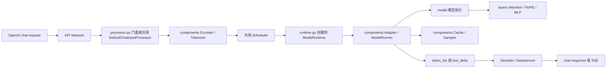

# 新模型接入教程与工程规范

本教程以一个固定版本的 Hugging Face 纯文字模型为例，讲解如何把新模型接入本仓库，并说明模型包、依赖、配置、Runtime 和发布验收的工程规范。对 Hub 模型，应固定上游 revision；对组织内部制品，应记录不可变制品版本或等效校验信息。模型能力按实际需要实现；Gateway 和 Live 媒体服务是可选发布路径。

教程以 [`Qwen/Qwen2.5-0.5B-Instruct`](https://huggingface.co/Qwen/Qwen2.5-0.5B-Instruct/tree/c89bee90d9f811437d9735454613c35b4a3c4dc8) 说明纯文字 `standard` profile。该模型仅作为可复现的讲解样例，不表示它已经登记为仓库模型，也不表示示例中的资源参数适合所有 GPU。模型快照包含模型配置、Safetensors、Tokenizer 和 chat template；ONNX 目录通过下载过滤排除。该 revision 对应的[固定版模型卡](https://huggingface.co/Qwen/Qwen2.5-0.5B-Instruct/blob/c89bee90d9f811437d9735454613c35b4a3c4dc8/README.md)说明其为 causal language model，并提供 Transformers 使用方式。

## 目标、适用范围与规范用语

- **必须**：任何新模型都要完成的要求，例如唯一 alias、模型内配置、Runtime 工厂、独立依赖 extra 和静态预检。
- **可选**：仅当模型真实提供相应能力时实现，例如 `tool_calling.py`、`live.py`、图片或视频编码器。
- **standard profile**：输入为纯文字、模型符合标准 causal LM/Cache 接口且能复用项目共用 Runner 和输入处理器的模型。
- **custom profile**：模型需要自定义拓扑、权重映射、Cache、模态预处理、增量输出或能力适配的模型。

本指南默认从仓库根目录和 `inference` Conda 环境执行 WSL/Linux Bash 命令。将模型部署到其他 OS、Python、PyTorch 或 CUDA 组合时，先重做对应环境验证。不要把参考配置直接视为生产容量承诺。

## 接入流程概览

| 步骤 | 产物 | 进入下一步骤的条件 |
| --- | --- | --- |
| 模型评估与定版 | 上游 `repo_id`、完整 revision、license/使用约束、模态与架构结论 | 确认模型来源、用途和硬件依赖可接受 |
| 权重下载 | `checkpoints/<snapshot>/` 完整本地快照 | 必需配置、权重、Tokenizer/Processor 文件均存在 |
| 模型包与依赖 | `src/inference/models/<package_name>/` 和对应 extra | Launcher 能发现模型，安装范围只包含目标模型依赖 |
| Runtime 与配置 | manifest、inference/network 配置、Runner/Adapter | 静态预检通过，能力声明与实现一致 |
| 运行时验证 | 健康检查、非流式和 SSE 请求证据 | 模型成功加载，输出、结束原因、用量和流终止符合预期 |
| 可选发布集成 | Gateway 路由；如使用 Live，再加媒体配置 | 认证、alias、路由和声明能力均有端到端证据 |

**控制原则：**某一步失败时先修复该步骤，不要通过临时改 alias、关闭校验、伪造能力或绕过配置来继续启动。

## 示例模型的上游定版

本示例固定 `Qwen/Qwen2.5-0.5B-Instruct` 的完整 commit `c89bee90d9f811437d9735454613c35b4a3c4dc8`，避免 `main` 移动后同一教程解析到不同权重和配置。Hugging Face Hub 支持按 revision 下载整个 snapshot，并使用 `ignore_patterns` 排除文件；revision 应使用完整 commit，而不是短哈希或可移动分支。[官方 snapshot 下载说明](https://huggingface.co/docs/huggingface_hub/en/guides/download)

| 定版项目 | 示例值 | 接入前要确认的内容 |
| --- | --- | --- |
| Hugging Face `repo_id` | `Qwen/Qwen2.5-0.5B-Instruct` | 来源可信、仓库类型为 model、访问权限满足部署要求 |
| revision | `c89bee90d9f811437d9735454613c35b4a3c4dc8` | 固定完整 40 位 commit；配置、权重、Tokenizer 来自同一 snapshot |
| 模型类型 | causal decoder-only text model | `AutoModelForCausalLM` 可识别，模型返回 logits 和可复用 Cache |
| 权重与 Tokenizer | Safetensors、Tokenizer JSON/config、Chat Template | 所有必要文件均来自固定 snapshot，离线加载不依赖 Hub |
| license | Apache-2.0（以[固定 revision 的 LICENSE](https://huggingface.co/Qwen/Qwen2.5-0.5B-Instruct/blob/c89bee90d9f811437d9735454613c35b4a3c4dc8/LICENSE)为准） | 使用方确认 license、数据政策和组织审批适用于目标场景 |
| Transformers 版本 | `5.19.0`（本项目示例依赖锁定） | 上游模型卡建议使用较新的 Transformers；升级该 pin 前必须验证模型加载、生成、Cache 与 SSE 回归 |

模型加载采用 Transformers 的 `from_pretrained()` Auto 类，具体类由模型配置识别；上游 Qwen 模型需要模型自带的 Chat Template，而不是由项目自行拼接特殊 token。[Transformers 模型加载](https://huggingface.co/docs/transformers/en/models)、[Chat Template](https://huggingface.co/docs/transformers/main/chat_templating)、[Qwen 官方模型卡](https://huggingface.co/Qwen/Qwen2.5-0.5B-Instruct)

## 导航

- [模型包目录标准](#模型包目录标准)
- [模型架构与组件职责](#目录和组件各自负责什么)
- [选择 standard 或 custom profile](#决定使用-standard-还是-custom)
- [三种模型包形态](#三种模型包形态)
- [请求数据流](#请求如何经过这些目录)
- [模块级调试和测试放置位置](#模块级调试和测试放哪里)
- [步骤 0：环境与硬件基线](#步骤-0环境与硬件基线)
- [步骤 1：下载固定 revision](#步骤-1下载固定-revision)
- [步骤 2：创建模型包](#步骤-2创建模型包)
- [步骤 3：登记运行依赖](#步骤-3登记运行依赖)
- [步骤 4：声明模型插件与 API 能力](#步骤-4声明模型插件与-api-能力)
- [步骤 5：配置模型、Engine 和网络](#步骤-5配置模型engine-和网络)
- [步骤 6：组装 Runtime](#步骤-6组装-runtime)
- [步骤 7：静态发现与配置预检](#步骤-7静态发现与配置预检)
- [步骤 8：启动 Inference 并验证 API](#步骤-8启动-inference-并验证-api)
- [步骤 9：可选的 Gateway 发布](#步骤-9可选的-gateway-发布)
- [验收口径与发布交接](#验收口径与发布交接)
- [故障处理与回退](#故障处理与回退)
- [custom profile 的接入要求](#custom-profile-的接入要求)
- [官方数据](#官方数据)

## 模型包目录标准

每个模型都放在 `src/inference/models/<package_name>/` 下。目录名使用 Python 包名格式（小写字母和下划线）；公开 alias、Hugging Face `repo_id` 与目录名各自独立。Launcher 通过每个模型的 `configs/model.yml` 发现模型，不需要在共用 API、Engine 或 Launcher 中增加模型名称分支。

### 每个模型都要有的骨架

```text
src/inference/models/<package_name>/
├── __init__.py                 # 让模型目录成为可导入的 Python 包
├── runtime.py                  # 必须：create_runtime() 连接模型 Runner/Adapter 与共用 Worker
├── example.py                  # 必须：最小可运行示例；文字模型默认展示流式输出
├── requirements.txt            # 必须：该模型单独安装所需的 Python 依赖
└── configs/                    # 必须：模型自己的配置，不从其他模型目录借配置
    ├── model.yml                # 必须：alias、profile、工厂路径、API 能力
    ├── inference.yml            # 必须：模型 revision、权重路径、dtype、Engine 等运行参数
    └── network.yml              # 必须：该模型 Inference 服务监听地址
```

`requirements.txt` 通过 `src/inference/pyproject.toml` 中同名的独立 extra 注册。例如目录名为 `qwen2_5_0_5b`，extra 名也用 `qwen2_5_0_5b`。这样不会因为安装一个模型而连带安装其他模型的专属依赖。开发环境可用 editable 安装；发布环境应构建并安装带目标 extra 的 wheel，不应依赖源码目录或 editable link。PyTorch/CUDA 是环境级依赖，应按目标机器单独准备，不要在模型 extra 中意外替换 CUDA 版 PyTorch。

本项目要求每个模型保留 `example.py`，但模型计算组件只按实际职责增加。**目录名统一，目录数量按模型需要**：没有自定义模型拓扑就不建 `model/`；没有自定义算子就不建 `layers/`；复用共用 Runner 和 Processor 时不建空的 `components/`。不要为了看起来整齐创建空模块，也不要把单模型逻辑放入共用 `engine/` 或 `network/`。

### 目录和组件各自负责什么

| 文件或目录 | 放什么 | 不要放什么 |
| --- | --- | --- |
| `configs/` | 本模型 manifest、推理配置和网络配置；所有模型都必须有 | Python 常量、密钥、别的模型配置路径 |
| `runtime.py` | `create_runtime()`：构造该模型 Runner 与 Adapter，并返回 `ModelRuntime`；所有模型必须有 | 模型全部计算细节、服务启动器、复制的 Scheduler/Worker |
| `model/` | 模型结构与网络拓扑：把 embeddings、各层、norm、输出 head 按官方结构组合起来；自定义模型需要 | 请求排队、HTTP 处理、Engine 生命周期 |
| `layers/` | 可独立检查、替换的数值计算模块，如 Attention、RoPE、MLP、RMSNorm、视觉编码层；需要自定义计算时创建 | 请求解析、Tokenizer、Cache 生命周期或模型整体拓扑 |
| `components/` | 模型执行周边协作组件，见下表；自定义 Runtime 需要拆分这些职责时创建 | 一整个庞大的 `InputProcessor`、通用 API 路由或重复的共用 Scheduler |
| `utils/loader.py` | 加载上游 Config/Tokenizer/Processor、读取固定 snapshot、权重 key/shape 转换；模型有专属加载流程时创建 | `max_context_tokens`、batch 大小等服务参数（这些放 YAML） |
| `processor.py` | API 输入/输出边界的薄门面；`custom + token_ids` 模型在 manifest 配 `api.input_processor` 时使用 | 把 Tokenizer、Encoder、Decoder、图像/视频预处理、sampling 全写进一个大类 |
| `tool_calling.py`（可选） | 把模型输出解析成项目标准 tool call，并维护流式增量解析；仅模型支持并启用工具调用时创建 | 执行外部工具。模型只提出调用，Agent/客户端负责授权和执行 |
| `live.py`（可选） | 该模型的 Live session manager 与实时帧生成适配；仅宣告 `live_video: true` 时创建 | MediaMTX 服务本身 |
| `example.py` | 该模型最短的可运行示例，优先展示实际流式输出；多模态模型加入一个小素材输入示例 | 大量测试矩阵或测试框架封装 |
| `requirements.txt` | 本模型直接依赖及经过验证的版本，配合 pyproject 的同名 extra 安装 | 所有模型共用的依赖大杂烩 |

`components/` 按单一职责命名。对话输入链路可拆成：

| 组件 | 输入与输出 | 主要职责 |
| --- | --- | --- |
| `encoder.py` | 标准 chat request → 模型输入计划 | 校验/规范化消息，分离文字、图片、视频内容，准备模型需要的元信息和生成参数；不要在这里实现 Attention |
| `tokenizer.py` | 消息/文字 → token IDs | 加载或调用该模型的词表及 Chat Template；若上游 `AutoProcessor` 同时做图像预处理，就清晰说明并复用它，不要复制上游逻辑 |
| `decoder.py` | 完整 token ID 序列 → 最终文字 | 处理完整结果的解码规则；不持有模型权重或 KV Cache |
| `detokenizer.py` | 单个新 token → 当前可安全显示的文字片段 | 维护请求级增量解码状态，避免把跨 token 的字节/特殊 token 错误切开 |
| `model_runner.py` | Scheduler 的 `ScheduledWorkItem` → Worker 结果 | 执行 prefill/decode，调用模型前向，持有每个请求的生成状态与 Cache，并处理取消/结束 |
| `adapter.py` | 共用 `ModelRuntime` 契约 ↔ 模型 Runner | 转换共用请求、采样选项、Cache 绑定与结果；对接共用 Worker，不重复实现调度器 |
| `input_batch.py` | 多个 request 的输入计划 → 实际 batch 张量 | 只有模型真正支持合批时才创建；不能仅有文件就宣称支持 batch |
| `sampler.py` | logits + 生成历史 + 参数 → 下一个 token | 只有模型采样行为与共用实现不同，或需要模块级分析时才创建 |
| `paged_kv_cache.py` / `cache_manager.py` | request/block 操作 → 模型实际 Cache 状态 | 管理模型自身 Cache 的物理读写；与共用 Engine 的 block reservation 区分开 |

`model/` 表示**整张模型计算图如何组成**；`layers/` 表示**图中的数值计算块**；`components/` 表示**输入、生成、Cache 和共用引擎契约的协作流程**。例如，Attention 的矩阵计算应在 `layers/attention.py`，由哪些 decoder block 按什么顺序组成网络写在 `model/<model>.py`，每个请求如何分块 prefill、更新 Cache 并把 logits 转成 Worker 结果写在 `components/model_runner.py` / `components/adapter.py`。

### 决定使用 standard 还是 custom

| 判断项 | standard 可复用路径 | custom 模型专属路径 |
| --- | --- | --- |
| 输入模态 | 纯文字 `chat_inputs: [text]` | 图片/视频、特殊消息结构或专属 Processor |
| 模型加载 | `AutoModelForCausalLM` 可直接加载本地 snapshot | 自定义拓扑、权重 key/shape 转换、`trust_remote_code` 经过审查后必需 |
| 生成协议 | logits + Transformers 可复用 `past_key_values`，可逐步 decode | 专属 Cache、非标准生成状态、模型输出已是 `text_delta` |
| API 输入输出 | token IDs + 共用 `DefaultChatInputProcessor` | 模型专属 Encoder/Tokenizer/Decoder/Detokenizer 或视频/Live 方法 |
| 实现位置 | `runtime.py` 组合共用 `StandardTextModelRunner`/Adapter | 模型包 `model/`、`layers/`、`components/`、`processor.py` 按职责实现 |

Launcher 的静态检查会阻止 standard profile 宣告图片、视频上传或 Live；但静态检查无法证明模型真实的 Cache 语义。遇到一项不满足，就按 custom 设计并通过运行测试证明契约；不能把多模态数据剥掉后冒充 text-only 来通过检查。

`model.yml` 中的 capability 是服务契约，不是模型卡能力的复述。每个 `true` 都要有相应处理代码和验收证据：`streaming` 必须在 SSE 返回真实增量；`tool_calling` 必须配 tool adapter 并支持声明的解析形式；`video_upload` / `live_video` 必须实现相应 Runtime 方法和限制配置。未实现时保持 `false`。

### 三种模型包形态

**A. 可复用 standard profile 的纯文字模型（本教程的 Qwen2.5）**只使用共用 `StandardTextModelRunner` 和 `DefaultChatInputProcessor`：

```text
qwen2_5_0_5b/
├── __init__.py
├── runtime.py                  # 组合共用 Runner + Adapter
├── example.py
├── requirements.txt
└── configs/
    ├── model.yml
    ├── inference.yml
    └── network.yml
```

这种形态**没有**模型专属 `model/`、`layers/`、`components/`、`utils/loader.py` 和 `processor.py`。模型结构与 cache 由 Transformers 提供；manifest 不填写 `api.input_processor`，Launcher 会选择共用默认处理器。若缺少 Chat Template、模型 forward 不返回可复用的 `past_key_values`，或输入不是纯文字，就不能继续套 standard。

**B. 自研文字计算图的 custom 模型（参考 Qwen3）**：

```text
qwen3_0_6b/
├── __init__.py
├── runtime.py
├── example.py
├── processor.py                # API 薄门面，组合小组件
├── tool_calling.py             # 可选：仅支持并启用工具调用时需要
├── requirements.txt
├── configs/
├── model/qwen3.py              # 官方 Qwen3 网络拓扑与模型 forward
├── layers/                     # attention.py、rope.py、layers.py 等计算块
├── components/
│   ├── adapter.py
│   ├── model_runner.py
│   ├── encoder.py
│   ├── tokenizer.py
│   ├── decoder.py
│   ├── detokenizer.py
│   ├── sampler.py
│   ├── input_batch.py
│   └── paged_kv_cache.py
└── utils/loader.py             # 配置、Tokenizer 与权重加载/映射
```

Qwen3 的 `processor.py` 只组装 Encoder、Tokenizer、Decoder；真正的计算图在 `model/`、算子在 `layers/`、逐请求执行和 Cache 在 `components/`。它的 Cache 是模型内部实体 KV page；共用 Engine 负责 Scheduler 和 block reservation，两者不要混为一谈。

**C. 上游多模态模型（参考 Mage-VL）**也使用同一套根目录与 `configs/`，但按实际模态增加组件：

```text
mage_vl_4b/
├── __init__.py
├── runtime.py
├── example.py
├── processor.py                # 兼容入口；具体逻辑仍在 components/
├── live.py                     # 可选：仅声明 live_video: true 时需要
├── requirements.txt
├── configs/
├── model/                      # 多模态模型与视觉/文字子网络拓扑
├── layers/                     # 视觉与文字网络层、RoPE、Attention 等
├── components/
│   ├── adapter.py
│   ├── model_runner.py
│   ├── encoder.py
│   ├── image_encoder.py
│   ├── video_encoder.py
│   ├── tokenizer.py
│   ├── decoder.py
│   ├── detokenizer.py
│   ├── stepwise_generation.py
│   ├── cache_manager.py
│   └── component_registry.py
└── utils/loader.py
```

Mage-VL 复用上游 `AutoProcessor` 处理文字和视觉输入，不要为了目录对称再实现一套词表或视觉预处理。`image_encoder.py`、`video_encoder.py` 和 `live.py` 只在模型真正提供这些能力时需要。可直接查看 `src/inference/models/qwen3_0_6b/` 与 `src/inference/models/mage_vl_4b/` 中对应的实现作为项目内样板。

### 请求如何经过这些目录



`processor.py` 在 API 进程处理输入与增量输出；`runtime.py` 创建的 Runtime 在 Worker 进程执行模型。通常 Encoder/Tokenizer 在生成前准备输入，ModelRunner 执行 forward，Decoder/Detokenizer 负责完整解码或 SSE 片段。具体模块应顺着数据流组合，避免互相导入整套模型，形成循环依赖。

### 模块级调试和测试放哪里

`layers/` 中的计算模块应提供小尺寸、可重复的前向验证入口（适合时用 `if __name__ == "__main__":`），检查输入输出 shape、dtype、device、数值有限性，并与官方 Transformers 对应层或简化公式对照。该入口只做组件级诊断，不加载整套服务、不下载权重、不取代 `tests/` 的验收脚本。模型的集成、性能与端到端脚本仍放在 `tests/<package_name>/`，不要放到 `scripts/` 或模型包的 `components/`。

### 步骤 0：环境与硬件基线

以下命令在仓库根目录的 WSL/Linux Bash 中运行。PyTorch CUDA wheel 需要与本地驱动、CUDA 运行时匹配；不要让模型 extra 替你重装 PyTorch。

```bash
conda activate inference
python -c "import torch; print('torch:', torch.__version__); print('cuda:', torch.cuda.is_available()); print('gpu:', torch.cuda.get_device_name(0) if torch.cuda.is_available() else 'CPU fallback')"
```

环境基线应显示 `cuda: True` 和 GPU 名称。项目的 `torch_cuda` Platform 会优先使用 CUDA，仅 `torch.cuda.is_available()` 为 false 时回退到 CPU；CUDA 可用但显存不足时会报错，不会自动把模型切到 CPU。记录 GPU 型号、显存、驱动、PyTorch/CUDA 版本；没有足够显存时，先调整并重新记录模型参数，不能把 OOM 当作自动 CPU fallback。

先确保下载脚本依赖已安装。若当前环境已经有 `huggingface_hub`，此命令会保持当前版本：

```bash
python -c "import huggingface_hub; print(huggingface_hub.__version__)" || python -m pip install "huggingface_hub==1.33.0"
```

### 步骤 1：下载固定 revision

必须从仓库根目录运行。不要用 `main` 代替 revision；固定 commit 才能保证配置、权重和 Tokenizer 来自同一版快照。

```bash
python scripts/download.py \
  --repo-id Qwen/Qwen2.5-0.5B-Instruct \
  --revision c89bee90d9f811437d9735454613c35b4a3c4dc8 \
  --local-dir checkpoints/Qwen2.5-0.5B-Instruct-c89bee \
  --ignore-pattern 'onnx/**'
```

脚本结束时应打印 `download_status: complete`。完整文件位于根目录 `checkpoints/`，该目录由 `.gitignore` 忽略，不要把权重或 Hub 缓存提交到 Git。使用 `local_dir` 时，Hub 会在目标目录创建 `.cache/huggingface/` 下载元数据；这不是模型权重，保留它能改善同一 snapshot 的续传与重复下载体验。

对于 gated 或私有仓库，下载脚本默认从 `HF_TOKEN` 环境变量读取凭据（可用 `--token-env` 改名）。使用组织批准的 secret store 或受保护的环境配置注入 token；不要将 token 写入 YAML、脚本、命令历史、日志或 Git。[Hub 环境变量说明](https://huggingface.co/docs/huggingface_hub/package_reference/environment_variables)

```bash
python - <<'PY'
from pathlib import Path

snapshot = Path("checkpoints/Qwen2.5-0.5B-Instruct-c89bee")
required = ("config.json", "generation_config.json", "model.safetensors", "tokenizer.json", "tokenizer_config.json")
missing = [name for name in required if not (snapshot / name).is_file()]
if missing:
    raise SystemExit(f"模型快照缺少文件：{missing}")
print(f"模型快照检查通过：{snapshot.resolve()}")
PY
```

文件检查只证明 snapshot 中的必要文件存在，不能证明 Transformers 能加载、GPU 兼容或生成质量符合业务要求。遇到 401/403 时，确认模型访问审批、账号权限和 `HF_TOKEN` 注入；revision 不存在时，确认使用完整 commit 哈希。本示例模型公开下载，但仍须遵守它在固定 revision 中附带的 license。

### 步骤 2：创建模型包

新模型包名、公开 alias 和 Hugging Face `repo_id` 是三种不同标识。本例选用：

| 标识 | 本例值 | 写在哪里 |
| --- | --- | --- |
| Python 包目录 | `qwen2_5_0_5b` | `src/inference/models/` |
| 对外 alias / Inference `api.model_id` | `qwen2.5-0.5b-instruct` | `configs/model.yml` |
| Hugging Face `repo_id` | `Qwen/Qwen2.5-0.5B-Instruct` | `configs/inference.yml` 的 `model.id` |
| 固定 revision | `c89bee90d9f811437d9735454613c35b4a3c4dc8` | `configs/inference.yml` 的 `model.revision` |

创建目录和空的 Python 包入口：

```bash
mkdir -p src/inference/models/qwen2_5_0_5b/configs
touch src/inference/models/qwen2_5_0_5b/__init__.py
```

把 `src/inference/models/qwen2_5_0_5b/__init__.py` 写成模型包的统一 Engine Client 入口：

```python
from importlib import import_module
from pathlib import Path

from inference.engine.engine_client import EngineClient, create_engine_client_for_package


def create_engine_client(
    *,
    inference_config_path: str | Path | None = None,
    network_config_path: str | Path | None = None,
) -> EngineClient:
    return create_engine_client_for_package(
        import_module(__name__),
        inference_config_path=inference_config_path,
        network_config_path=network_config_path,
    )


__all__ = ["create_engine_client"]
```

Qwen2.5 的 `standard` 包只需要上述入口、`runtime.py`、`example.py`、`requirements.txt` 和三个 YAML；不需要复制 Qwen3 的 `model/`、`layers/`、`components/` 或 `utils/loader.py`。模型拓扑与 Cache 由共用 `StandardTextModelRunner`/Transformers 负责，Tokenizer/Chat Template 由共用 `DefaultChatInputProcessor` 负责。

### 步骤 3：登记运行依赖

创建 `src/inference/models/qwen2_5_0_5b/requirements.txt`：

```text
transformers==5.19.0
accelerate==1.15.0
safetensors==0.8.0
```

项目把每个模型的依赖作为独立 extra 安装。打开 `src/inference/pyproject.toml`，在 `[tool.setuptools.dynamic.optional-dependencies]` 中增加一行：

```toml
qwen2_5_0_5b = { file = ["models/qwen2_5_0_5b/requirements.txt"] }
```

然后从仓库根目录安装本项目和这个模型 extra：

```bash
# 本地开发：editable 安装，便于直接调试源码。
python -m pip install -e "src/inference[qwen2_5_0_5b]"
python -m pip check
```

发布环境不要使用 editable 安装。完成代码审查和版本定版后，构建并安装 wheel；交付时应把 wheel 与该模型的依赖 extra 作为同一发布单元：

```bash
python -m pip install build
python -m build --wheel --outdir dist src/inference
python -m pip install "dist/inference-0.1.0-py3-none-any.whl[qwen2_5_0_5b]"
python -m pip check
```

wheel 文件名包含项目版本；若 `inference.__version__` 已更新，应使用构建生成的实际文件名。生产部署还应使用锁定的 Python/系统依赖镜像，并在制品仓库记录 wheel 的版本与校验值。权重和环境配置作为独立部署制品提供，不能假定它们包含在 Python wheel 中。

PyPA 将这类可按功能安装的依赖称为 packaging extra；本仓库通过 setuptools 从模型 `requirements.txt` 动态生成 extra。安装命令必须只选择目标模型 extra，不能用 `inference[all]` 或把其他模型 extra 一起安装到单模型环境。[Python Packaging：`pyproject.toml` 和 optional dependencies](https://packaging.python.org/en/latest/guides/writing-pyproject-toml/)

CUDA 版 PyTorch 是环境级依赖，需在安装前按机器选择正确的 wheel。模型 extra 只安装模型需要的 Transformers、Accelerate 和 Safetensors，不应把另一模型的依赖一起装进来。`pip check` 应无依赖冲突；再记录 `python --version`、`torch.__version__`、`transformers.__version__` 与 CUDA 设备信息，作为本次构建的运行环境基线。

### 步骤 4：声明模型插件与 API 能力

创建 `src/inference/models/qwen2_5_0_5b/configs/model.yml`：

```yaml
alias: qwen2.5-0.5b-instruct
display_name: Qwen2.5-0.5B-Instruct
integration_profile: standard
backend: transformers_standard_text
runtime_factory: inference.models.qwen2_5_0_5b.runtime:create_runtime
inference_config: inference.yml
network_config: network.yml
api:
  model_id: qwen2.5-0.5b-instruct
  capabilities:
    chat_inputs: [text]
    streaming: true
    tool_calling: false
    output_mode: token_ids
    video_upload: false
    live_video: false
```

本例**不写 `api.input_processor`**：`standard` profile 会选用项目的 `DefaultChatInputProcessor`，它读取模型自己的 Chat Template，并负责 tokenize 与 stream detokenize。仅当模型要定制输入处理时才登记自己的工厂。`tool_calling` 保持 `false`；即便模型卡提到工具能力，也必须先实现工具适配器并完成验收才可以改为 `true`。

### 步骤 5：配置模型、Engine 和网络

创建 `src/inference/models/qwen2_5_0_5b/configs/inference.yml`：

```yaml
model:
  id: Qwen/Qwen2.5-0.5B-Instruct
  revision: c89bee90d9f811437d9735454613c35b4a3c4dc8
  dtype: float16
  device: cuda:0

runtime:
  platform: torch_cuda
  local_model_path: checkpoints/Qwen2.5-0.5B-Instruct-c89bee
  local_files_only: true
  worker_startup_timeout_seconds: 900
  worker_request_timeout_seconds: 300
  engine_core_startup_timeout_seconds: 930
  engine_core_request_timeout_seconds: 330

api:
  max_chat_request_bytes: 2097152
  max_context_tokens: 4096

engine:
  max_num_seqs: 2
  max_waiting_requests: 8
  max_num_scheduled_tokens: 2048
  batch_wait_seconds: 0.01
  prefill_chunk_size_tokens: 512
  kv_cache:
    block_size_tokens: 16
    num_blocks: 640

generation:
  max_new_tokens: 128
  temperature: 0.0
  top_p: 1.0
  top_k: 0
  min_p: null
  repetition_penalty: 1.0
  no_repeat_ngram_size: 0
  num_beams: 1
```

以上数值是此 Qwen2.5 示例的 smoke 起始配置，不是生产容量建议。`max_context_tokens: 4096` 是服务侧的输入加输出总 token 限额，必须不超过模型支持的位置范围；它不要求使用模型的最大上下文。以本组参数计算，Scheduler 的逻辑 KV 预算为 `640 × 16 = 10,240` token；两个并发请求各自最多预留 4,096 token，总需求为 8,192 token，逻辑预算余量为 2,048 token。实际部署应根据目标并发、输入长度分布、生成上限和显存测量重新定值。

在 `standard` profile 中，Engine KV block 是 Scheduler 的容量租约，实际历史 K/V 由 Transformers Cache 按请求保存；这不代表模型使用了项目的实体 paged KV。`max_num_scheduled_tokens` 和 `prefill_chunk_size_tokens` 控制调度与分块 prefill，不会改变模型原生上下文能力。`float16` 也必须由目标 GPU 与模型支持；若使用 BF16，需同时验证硬件支持、模型输出和性能，不应仅因某个 dtype 更快就修改配置。

创建 `src/inference/models/qwen2_5_0_5b/configs/network.yml`：

```yaml
api:
  host: 127.0.0.1
  port: 8012
```

本示例使用 Inference 端口 8012；实际端口必须与同一主机上的现有服务错开，并以模型 `network.yml` 为准。

`127.0.0.1` 只适用于同一网络命名空间内的本地调用。如果 Gateway 部署在 Docker 或其他主机，必须把上游地址设为该部署网络中可达的 Inference 地址，并按组织的防火墙策略限制暴露范围；不要为了联通而直接把推理服务绑定到公网接口。

### 步骤 6：组装 Runtime

创建 `src/inference/models/qwen2_5_0_5b/runtime.py`：

```python
"""Qwen2.5 文字模型使用共用 Transformers standard Runtime。"""

from inference.engine.standard_text import StandardTextModelAdapter, StandardTextModelRunner
from inference.engine.worker import ModelRuntime


def create_runtime() -> ModelRuntime:
    runner = StandardTextModelRunner()
    adapter = StandardTextModelAdapter(runner)
    return ModelRuntime(runner, adapter)
```

这个小工厂是模型包接入共用 Worker 的边界。权重加载时，`StandardTextModelRunner` 以 `model.id` 对应的本地目录调用 `AutoModelForCausalLM.from_pretrained`，使用固定 revision、配置中的 dtype 和 CUDA 设备。它会检查模型是 causal decoder，并要求 forward 返回可复用的 `past_key_values` 和 logits。Tokenizer 由共用 `DefaultChatInputProcessor` 从同一快照加载。

模型目录中的 `example.py` 按项目约定展示 Tokenizer 准备输入、Engine 逐 token 生成和增量 Detokenizer 打印。它会自行启动 Engine Core 与 Worker，不需要先启动步骤 8 的 HTTP 服务；两种运行方式各自都会加载一份模型，验收时分开运行，避免重复占用显存。下面的代码刻意保持短小以展示数据流；长期服务应在应用启动/关闭钩子中创建与关闭 Engine 和 Processor，并用 `try/finally` 或等效生命周期机制确保异常时清理进程与显存：

```python
from pathlib import Path

from inference.models.qwen2_5_0_5b import create_engine_client
from inference.network.default_chat_processor import DefaultChatInputProcessor

INFERENCE_CONFIG = Path(__file__).resolve().parent / "configs" / "inference.yml"

engine = create_engine_client(inference_config_path=INFERENCE_CONFIG)
processor = DefaultChatInputProcessor()
processor.start()
request = {
    "model": "qwen2.5-0.5b-instruct",
    "messages": [{"role": "user", "content": "用一句话介绍 KV Cache。"}],
    "max_tokens": 64,
}
prepared_input = processor.prepare_chat(request)
engine.start()
detokenizer = processor.create_stream_output_processor()
stream = engine.stream_chat(request, prepared_input)

for event in stream:
    if event.kind == "token" and event.token_id is not None:
        print(detokenizer.push(event.token_id), end="", flush=True)
    elif event.kind == "finish":
        print(detokenizer.finish(), end="", flush=True)
print()

stream.close()
processor.close()
engine.close()
```

如果你的模型不能通过 `AutoModelForCausalLM` 加载，输出不是标准 causal LM logits/cache，使用多模态输入，或需要专属 Cache/权重 key 转换，就不要勉强套这段工厂；应改走下文的 `custom` profile。

### 步骤 7：静态发现与配置预检

先从仓库根目录执行：

```bash
inference list
inference validate --model qwen2.5-0.5b-instruct
```

`list` 应出现新 alias；`validate` 应报告 `valid profile=standard`。这一步会检查 manifest、YAML、工厂路径、依赖于模型能力的必需字段和固定 revision 格式，**不会下载或加载权重，也不会初始化 GPU**。如果失败，先修复错误并重复该步骤，不要直接启动服务。

### 步骤 8：启动 Inference 并验证 API

在终端 A 启动服务：

```bash
inference start --model qwen2.5-0.5b-instruct
```

首次加载应只读本地权重，因为 `local_files_only: true`。启动成功后，在终端 B 检查健康状态和普通聊天：

```bash
curl --fail http://127.0.0.1:8012/health

curl --fail http://127.0.0.1:8012/v1/chat/completions \
  -H 'Content-Type: application/json' \
  -d '{
    "model": "qwen2.5-0.5b-instruct",
    "messages": [{"role": "user", "content": "用一句话解释什么是 KV Cache。"}],
    "max_tokens": 32,
    "stream": false
  }'
```

HTTP 状态应为 200，响应的 `model` 应为 `qwen2.5-0.5b-instruct`，`choices[0].message.content` 非空。再验收 SSE：

```bash
curl --no-buffer --fail http://127.0.0.1:8012/v1/chat/completions \
  -H 'Content-Type: application/json' \
  -d '{
    "model": "qwen2.5-0.5b-instruct",
    "messages": [{"role": "user", "content": "只回答：流式正常"}],
    "max_tokens": 16,
    "stream": true
  }'
```

SSE 应逐段输出 `data: ...`，最后以 `data: [DONE]` 收尾。若服务启动时报找不到文件，检查 `local_model_path` 是否相对仓库根目录、文件是否下载齐全，以及 `local_files_only` 是否为 true；若报 CUDA OOM，先降低 `max_num_seqs`、`max_context_tokens` 和 KV block 总数，再重新验收。

### 步骤 9：可选的 Gateway 发布

只通过 Inference API 使用模型时，不需要改 Gateway。要从 Gateway 公开时，在 `src/gateway/configs/gateway.yml` 的 `models` 下追加：

```yaml
  qwen2.5-0.5b-instruct:
    upstream_model: qwen2.5-0.5b-instruct
    base_url: http://127.0.0.1:8012
    capabilities:
      text_chat: true
      image_chat: false
      streaming: true
      tool_calling: false
      video_upload: false
      live_video: false
```

Gateway 的 `upstream_model` 必须等于模型 manifest 的 `api.model_id`，alias 则是客户端传给 Gateway 的 `model` 值。配置 `VIDEO_API_KEY` 后可用 `tests/client.py` 的普通聊天方式，或把 `tests/<package_name>/test_end2end.py` 的 URL、alias 和 `test.yml` 指向新模型，做带认证的 Gateway 验收。Gateway `/readyz` 会检查配置中的全部上游；若现有 Mage-VL/Qwen3 上游没启动，readyz 不会全绿，这不代表新模型的 8012 路由失败。先直接检查新模型的 `/health` 和 chat，再判断 Gateway 路由。

## 验收口径与发布交接

各步骤的验证结论必须与证据层级一致：

- **下载完成**只证明固定 revision 的文件已落盘，不证明该模型可由当前 Transformers 版本加载。
- **`inference validate` 成功**只证明 manifest、配置、工厂路径和静态能力检查通过，不会加载权重或初始化 GPU。
- **`GET /health` 成功**证明 API 和 Worker 已启动并报告运行状态，不证明模型能够处理 chat 请求。
- **非流式 chat 成功**证明一次请求完成；**SSE 成功**还必须观察到文本增量和 `data: [DONE]`。两者都不证明负载容量、吞吐 SLA 或任务精度。
- **Gateway 验收**只在对外路由时需要；必须单独验证认证、公开 alias、上游 `api.model_id`、非流式与 SSE 路由。Inference 直连成功不能代替 Gateway 验收。

交付前应把代码 commit、模型 `repo_id` 与完整 revision、配置版本、模型依赖版本、Python/PyTorch/CUDA/GPU 信息，以及各步骤实际命令和脱敏结果写入变更记录或发布记录。API key、HF token、原始请求中的个人信息和完整敏感日志不得写入记录。未执行的验证必须明确标为“未验证”，不要把计划、静态检查或一次短请求写成容量与质量结论。

## 故障处理与回退

| 现象 | 优先检查 | 处理原则 |
| --- | --- | --- |
| 下载返回 401/403 | repo 是否 gated、账号权限、`HF_TOKEN` 是否注入到执行下载的环境 | 走组织批准的访问审批；不把 token 放进 YAML 或命令参数 |
| revision 或文件不存在 | revision 是否为完整 commit；上游仓库是否在该 revision 包含 `model.safetensors`、配置和 Tokenizer | 先修正源版本与文件过滤，再重下快照；不要临时换 `main` 后沿用旧配置 |
| `inference validate` 失败 | 模型 alias 唯一性、manifest 路径、文件名大小写、`runtime_factory` 符号、能力字段 | 按报错修复 manifest/配置；不要通过降低能力校验或改共用路由绕过 |
| Chat Template 或 tokenizer 加载失败 | 固定 snapshot 中是否包含 `tokenizer_config.json`、`tokenizer.json` 和有效 `chat_template` | standard profile 依赖上游模板；若模型没有兼容模板，提供模型专属 processor 或改走 custom profile，不要自行伪造上游特殊 token |
| worker 找不到权重 | `local_model_path` 是否相对仓库根目录、`local_files_only` 是否启用、下载目录文件是否完整 | 修正本地路径并重新执行启动；部署环境不应在服务启动时意外访问网络 |
| CUDA OOM | 权重 dtype、上下文、并发、生成上限、其他进程的显存占用 | 依序降低并发和上下文预算，重新测量；CUDA 可用但显存不足时不会自动 fallback CPU |
| health 正常但 chat 失败 | Worker 日志、Tokenizer 准备结果、模型 forward 的 logits/Cache 返回、请求上限 | 用单一短 prompt 定位加载、输入、前向或采样环节；不要用健康状态代替请求验收 |
| Gateway `/readyz` 未就绪 | 配置中的其他上游是否也启动、`base_url` 和 upstream model 是否匹配 | 先直连检查目标 Inference；区分目标模型路由故障和其他上游未就绪 |

若发布后要回退，应恢复该模型对应的代码 commit 与配置版本，移除或停用其 Gateway 路由，并按组织的权重保留策略管理本地 checkpoint。不得回退共用 API/Engine 来掩盖单模型配置错误，也不得清理其他模型的 checkpoint。

## custom profile 的接入要求

当模型使用图片/视频输入、自定义计算图、特殊权重映射或 Cache、非标准文本增量时，不能只复制 standard YAML。custom profile 应按以下责任实现：

1. **Loader 与模型图**：在 `utils/loader.py` 读取固定 snapshot、加载准确的 Transformers Config/Processor，或映射上游 checkpoint key；在 `model/` 组装官方模型拓扑，在 `layers/` 实现需要自研或替换的数值计算。每个算子保留官方 shape、dtype、RoPE、mask、残差和 norm 语义，并提供可直接运行的小型前向对照。
2. **Runner 与 Adapter**：`components/model_runner.py` 实现模型加载、prefill/decode、Cache 状态和取消/结束清理；`components/adapter.py` 把请求和 `ScheduledWorkItem`/`WorkerResult` 转成模型 Runner 能处理的数据。`runtime.py:create_runtime()` 必须返回组合好的 `ModelRuntime`。

   `ModelRuntime` 必须满足 `load`、`gpu_status`、`close`、`health_info`、`generation_options`、`prepare_chat_generation`、`bind_generation_cache`、`execute_batch`、`finish_chat_generation`、`cancel_generation`。启用 `video_upload` 时，还必须提供 `prepare_video_generation`/`finish_video_generation`；启用 `live_video` 时，还必须提供 `prepare_live_frames_generation`、`prepare_live_video_generation` 和 `finish_live_generation`。共用 Worker 在启动时会按 manifest 能力检查这些方法。
3. **输入和输出**：按需要拆分 Encoder、Tokenizer、Decoder、Detokenizer、图像/视频编码器；`processor.py` 仅保留 API 边界需要的薄门面。`token_ids` 输出的 custom 模型必须在 manifest 配置 `api.input_processor`，并实现 `start`、`prepare_chat`、`close`、`decode_tokens` 和 `create_stream_output_processor`。
4. **能力与契约**：tool calling、video upload、Live 必须同时具备相应 adapter/manager、Runtime 方法和配置，并在 `model.yml` 如实声明。工具调用解析只负责生成标准 tool call，不执行外部工具；Agent/客户端仍负责授权和执行。
5. **逐级验证**：先做层级 shape/数值对照，再做 Runner 与 Cache 生命周期验证，然后执行 `test_components.py`、`test_performance.py` 和 `test_end2end.py`。三个测试脚本放在 `tests/<package_name>/`；算子分析脚本放 `scripts/<package_name>/`，两者用途不能混用。

项目中的 Qwen3 是自研 PyTorch 文字图与实体 KV page 的参考；Mage-VL 是上游 Transformers 多模态骨干并由模型包负责输入和视频能力的参考。具体文件可对照 `src/inference/models/qwen3_0_6b/` 与 `src/inference/models/mage_vl_4b/`。不要因为模型共用 HTTP endpoint，就把模型计算图、Tokenizer、Cache 或加载流程移进共用 `engine/`。

## 官方数据

- [Hugging Face Hub：下载文件与固定 revision](https://huggingface.co/docs/huggingface_hub/en/guides/download) — snapshot、完整 revision 与 `ignore_patterns`。
- [Hugging Face Hub：环境变量](https://huggingface.co/docs/huggingface_hub/package_reference/environment_variables) — `HF_TOKEN` 等凭据变量。
- [Transformers：模型加载](https://huggingface.co/docs/transformers/en/models) — Auto 类与 `from_pretrained()`。
- [Transformers：Chat Templates](https://huggingface.co/docs/transformers/main/chat_templating) — 角色消息、模板与 generation prompt。
- [Python Packaging User Guide：`pyproject.toml`](https://packaging.python.org/en/latest/guides/writing-pyproject-toml/) — optional dependencies 与 extras。
- [Qwen2.5-0.5B-Instruct：固定 revision 文件树](https://huggingface.co/Qwen/Qwen2.5-0.5B-Instruct/tree/c89bee90d9f811437d9735454613c35b4a3c4dc8)、[固定版模型卡](https://huggingface.co/Qwen/Qwen2.5-0.5B-Instruct/blob/c89bee90d9f811437d9735454613c35b4a3c4dc8/README.md)和[固定版 LICENSE](https://huggingface.co/Qwen/Qwen2.5-0.5B-Instruct/blob/c89bee90d9f811437d9735454613c35b4a3c4dc8/LICENSE) — 示例模型的架构、文件、依赖建议和许可信息。
