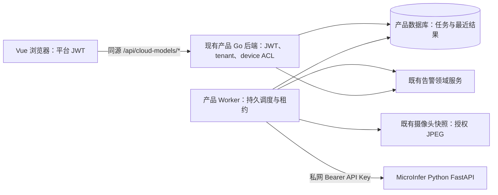

# 技术设计：控制面后端接入 cloud-vlm kit

> 关联规格：[spec.md](spec.md)；背景与取舍：[proposal.md](proposal.md)。
> 本文件描述未来产品后端，不是 MicroInfer 的实现说明。

## 现状与目标

| 部分 | 现状 | 目标 |
|---|---|---|
| 前端 | kit v1.9.9 是 Vue 沙箱，Cloud Models 页面仍为占位，浏览器调 Mock | 使用平台 apiFetch/JWT，改调产品后端同源 /api/* |
| 产品后端 | kit 指向 backend-go/api/openapi.yaml；源码不在此工作区 | 在现有产品后端仓库实现云模型模块与 Worker 角色 |
| 推理 | MicroInfer 是 Python FastAPI，含 API Key 校验与限流 | 作为私网推理上游，不增加 Go 代理，不恢复 Gateway |
| 摄像头/告警 | kit 要求复用既有快照和告警中心，实际接口未知 | 通过现有产品领域服务适配，不建立第二份事实来源 |

## 边界与请求流程

API 进程处理 JWT、业务授权和 HTTP 合同；后台 Worker 用同一产品后端领域模块，以独立进程角色执行。优先复用产品已有队列/调度器。检查真实后端前，不确定包路径、数据库或新增基础设施。

MicroInfer 仓库不再包含 Go 服务代码。图中的 Go 后端属于未来独立产品控制面，应该在产品后端仓库实现。

1. 浏览器使用平台 JWT 请求产品 API；认证和领域授权同时检查租户及设备、摄像头、任务归属。
2. 产品服务配置将业务 ID magevl-4b 映射到推理 ID mage-vl-4b；地址和凭据不由浏览器提供。
3. 创建任务时校验模型状态、权限、字段范围和重复组合；start 在持久层原子占用最多 4 个 running 名额。
4. start 快速返回完整任务；Worker 异步领取，浏览器按 kit 约每秒轮询任务状态。
5. Worker 从既有 FrameProvider 取 JPEG，检查来源、格式、大小及尺寸，禁止任意远程 URL。
6. Worker 非流式调用 POST /v1/chat/completions，使用 mage-vl-4b、提示词和单图；当前 API 不支持 response_format，不能依赖 JSON Schema 约束解码。
7. Worker 严格解析 hit、summary、confidence、labels；无效输出不触发告警，合格结果写入最近结果并调用现有告警服务幂等更新。
8. stop 递增任务版本或取消令牌；旧版本的在途推理不得复活任务或写入过期结果/告警。

## 数据与错误语义

- CloudTask 保存 kit 字段、tenant、状态、last_result、版本、next_run_at 与租约信息。TaskRun 可选，仅保存排障需要的元数据。
- 组合唯一约束、任务状态和四任务上限由数据库事务/锁保证，不能依赖进程内计数。实际字段类型、索引和迁移形式待查看产品 schema 后决定。
- 接口路径沿用 kit OpenAPI：模型目录、模型启停、frames/latest、tasks CRUD、start/stop，以及兼容期 alarms 查询。
- 按 kit 语义：未认证 401；权限失败 403/404；字段、模型或重复组合冲突 400；运行名额已满 429。运行中任务更新/删除拒绝。
- 告警读取首选前端复用既有告警 API 并过滤 model_type=cloud_vlm。如短期保留 kit alarms 路由，只能是既有告警服务的只读适配。

## Worker、容量和推理限制

- 优先使用产品已有持久队列。若无，则用数据库 next-run 与租约实现；PostgreSQL 可评估 FOR UPDATE SKIP LOCKED 领取队列任务，但该锁定方式不提供普通查询的一致性保证。
- 多 Worker 下单任务只能有一个有效租约；启动恢复过期租约；Stop/Update 后拒绝旧版本回写。
- 4 个 running 是业务配额，不代表 4 路并行推理。初始模型并发建议 1，按真实 4B 图像负载测试后调整；过期 tick 跳过或合并，不累积队列。
- Mage-VL 当前限制：单张图，最大边 896，图像 10 MiB，请求体 15 MiB。网络 YAML 当前每 key 5 req/s、突发 10；上线预检须确认部署值一致。
- 总请求超时建议先设 60 秒并经实际推理验证；仅对可安全重试的上游错误做有限退避；告警写入使用稳定幂等键。

## 安全、观测、发布

- API 接受产品 JWT；Worker 从产品密钥设施读取独立 Inference API Key。密钥不进入浏览器、源码、普通日志或任务数据。
- 查询始终含 tenant 与对象权限条件以防 BOLA/IDOR。推理地址、模型 ID 和图像来源用服务端白名单；拒绝客户端任意 URL 以降低 SSRF 风险。
- 仅接受必要图像格式，限制图片字节/尺寸及 HTTP 超时；日志只记录关联 ID、耗时、状态和错误类别，不记录原始帧或凭据。
- 观测队列长度、过期租约、运行数、推理并发、各阶段耗时、上游超时、解析失败、帧获取和告警写入错误；使用平台现有监控。
- 使用功能开关先部署关闭态，再 Mock 替换联调与单任务灰度。回滚时关开关、停止领取工作、使在途版本失效；保留任务和既有告警记录。

## 备选方案

| 方案 | 决定 |
|---|---|
| 在产品现有 Go 后端增加领域模块和 Worker 角色 | 推荐，复用身份、设备、数据库和告警；实际落点待看产品仓库；不在 MicroInfer 写 Go |
| 新建独立控制面微服务 | 首版不选，增加用户/设备/告警同步和运维边界 |
| 将控制面放进 MicroInfer FastAPI | 不选，混合业务授权与 GPU 推理职责 |
| Vue 直接请求 Inference | 禁止，会暴露推理密钥且缺失业务级授权 |

## 未决项

产品后端源码、数据库/迁移、JWT/RBAC、scheduler、快照服务、告警 upsert、模型 JSON 输出与 confidence 校准、Secret 管理和推理网络连通性，均须在实现前确认。

## 参考

- [OWASP API Security Project](https://owasp.org/projects/api-security-project)：对象级授权、认证和资源消耗风险。
- [PostgreSQL SELECT / locking clause](https://www.postgresql.org/docs/current/sql-select.htm)：SKIP LOCKED 可用于 queue-like 任务领取，不应作为通用一致性方案。

## 变更记录

| 日期 | 变更 |
|---|---|
| 2026-11-03 | 记录独立控制面的职责、执行流程、数据、安全和回滚设计。 |
